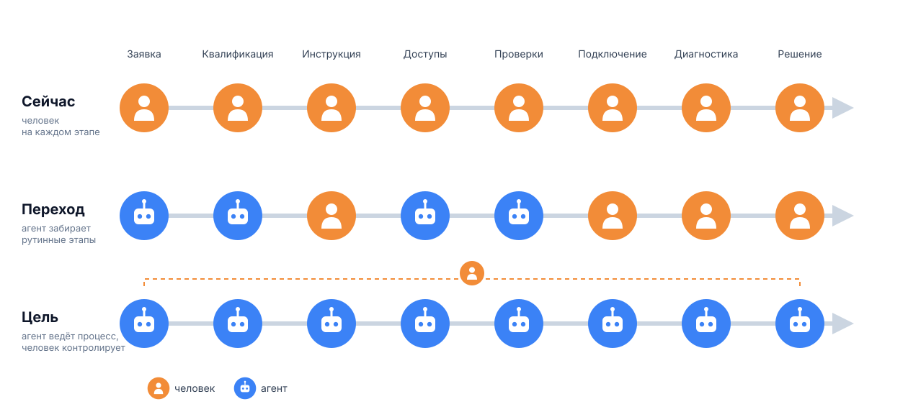

# Структура материала про автоматизацию (вводная часть, первый поток мыслей)

## Уровни автоматизации поддержки и инфры

О том, как сейчас автоматизируют работу поддержки и инфраструктуры и как вообще технические сотрудники используют ИИ. Условно это можно разложить по уровням — от полного отказа от ИИ до агентов в проде.

### Уровень 1. Не используют вообще

Первый вид — самый ужасный и странный: ИИ не используют совсем, непонятно почему. Таких, скорее всего, осталось мало: редкие экземпляры, **вымирающий вид**.

### Уровень 2. Чат для работы с текстом

Второй: используют просто чат — за подсказками или как генератор ответов, то есть **для работы с текстом**. Получше, но всё так же непонятно. Тоже краснокнижный вид.

### Уровень 3. Агенты для кода и диалогов

Третий: используют агентов вроде Claude Code и Codex для написания кода, а GPT — в основном для диалогов и более сложных сценариев, где подключаются поиск в интернете и deep research. Агентов уже используют, но **на несколько процентов от их возможностей**. Чаще всего речь идёт о тупом вайбкодинге.

Сюда же относятся и по-настоящему вредные случаи: **делегирование агенту мышления** или **бесконтрольное выполнение больших блоков задач**. Наша история не об этом. Она не про слабоумие и отвагу, а про **доверие, основанное на тактике и проверках**.

### Уровень 4. Продвинутое использование: MCP, скиллы, память

Четвёртый: агентов используют на более продвинутом уровне — подключают MCP (хотя бы к своей почте), пишут собственные скиллы. Повторяющиеся процессы фиксируют в логах, базе знаний, скиллах, памяти. **Это уже нормальный уровень**, и, наверное, большинство сейчас именно здесь.

### Уровень 5. Агентные воркфлоу

Пятый: строят агентные воркфлоу — **петли обратной связи, системы верификации, тесты, исполняемые спеки, хуки**. Хуки расширяют харнесс агента кастомным поведением: например, гарантированно запускают тесты на каждое значимое изменение или не дают выполнить опасное действие. Не вайбкодят бездумно, а понимают, что делают: где границы и зоны ответственности агентов, где они применимы. Human in the loop встраивают грамотно и осознанно.

Но и это ограничено: **на агента замыкают лишь небольшие фрагменты процессов.**

### Уровень 6. Агент на всём процессе

Логичное продолжение — замыкать на агента не фрагменты, а процесс целиком. Чтобы это представить, нужна схема: линия, а на ней — процесс от начала до конца. Например, обработка заявки:

1. заявка поступила;
2. заявка квалифицирована;
3. определено, по какой инструкции и какому скрипту действовать (имеется в виду скрипт для человека);
4. получены пароли, доступ к хранилищу и системам;
5. выполнены предварительные проверки, оценены метрики;
6. подключение к серверу;
7. диагностика;
8. выполнение решения или разговор с клиентом.

Даже такой простой пример — многоступенчатый процесс с множеством источников на входе и на выходе. Он нелинейный и ветвится в зависимости от ситуации, входных данных, времени суток, состояния среды. **Именно здесь начинается ускорение.** А вместе с ним — рост когнитивной нагрузки, но это отдельная тема.

Дойдя до этого, задаёшься вопросом: **почему бы на все этапы, где в цикле стоит человек, тоже не поставить агента?** Или хотя бы свести участие человека к минимуму, чтобы ускорить и удешевить процесс.

## Что мешает отдавать агентам новые процессы и этапы

Вопрос очевидный, но на практике так делают редко. Применение агентов в процессах и их частях упирается:

- в **отсутствие готовых инструментов** для агента: например, просто нет способа связать агента с условной CRM;
- в непонимание, как применить здесь агента. Точнее, даже не в непонимание, а в то, что **просто не приходит в голову, что его можно применить**: люди мыслят по-старому, привычки устоялись;
- в незнание, как всё настроить, как дать агенту доступ, как его контролировать;
- и самое страшное — в **страх и недоверие**: «Это ваши нейронки, это пузырь, они всё сломают», «Человек у меня — инженер получше».

**Именно эти барьеры держат большинство на четвёртом уровне — здесь сейчас и топчутся**: боятся, не представляют, что так вообще можно, считают, что это очень сложно.

## Следующий шаг: агент на инфраструктуре

Чтобы сдвинуться дальше, нужно увидеть, что агент умеет не только писать тексты, делать презентации и код. **Его можно запускать на инфраструктуре.** Причём не только для работы с самой инфраструктурой и ответов на вопросы, но и для довольно замысловатых задач по существующим системам — например, хитрой сборки конфигов для Kubernetes, смены конфигурации виртуальных машин, настройки сетевых доступов, деплоя приложений любой сложности.

Первое, что нужно, — **не побояться.** Не верить слепо стереотипу «так нельзя», пока кто-то не покажет, что можно. Или, что ещё хуже, пока так не начнут делать все, а ты будешь уже догонять.

### Модели больше не тупят

Страх во многом остался с тех времён, когда модели были заметно слабее. Год назад флагманские модели реально тупили, не говоря уже о всяких DeepSeek и Kimi. Сейчас Opus 5.5 и даже последние версии DeepSeek глупых ошибок не делают. Современные агенты — Cursor, Claude, OpenAI Codex — не тупят.

**За почти год, что я применяю агентов в инфраструктуре — сначала на локальной машине, потом в проде, — они ошибаются реже, чем я руками, реже, чем человек.**

Это как страх перед беспилотными автомобилями: кажется, что они всех угробят. Но люди гробят чаще, чем машины. **Машина — более точный механизм, чем человек**, а человеческий фактор никто не отменял. Если начать пользоваться и пройти этот путь, агент работает отлично: разбирается и нормально справляется.

## Три проблемы

При этом страх возник не на пустом месте: реальные проблемы есть, и их три.

1. **Нет гарантий, что агент ничего не сломает.** В отличие от программной автоматизации: написал код, отревьюил — и считаешь, что всё будет окей. Баги есть везде, а где их нет — их просто ещё не нашли. Но такой степени уверенности нам хватает, и **с агентом её тоже можно обеспечить**.
2. **У нейросети нет знаний, как решать конкретную задачу.** Даже решив её один раз, агент не обязательно это запомнит. Даже если сохранять документы и логи, воспроизвести по ним решение той же или похожей задачи в следующий раз нетривиально. А если таких документов тысячи и десятки тысяч, а задачи всё сложнее?
3. **Стоимость.** Если решать в лоб, будет дорого.

## Как преодолеть три барьера

У каждой проблемы есть своё решение.

### 1. Безопасность: тулсеты, MCP, хуки, защитные механизмы

Нужен **слой детерминированных тулов и хуков** — детерминированный код, который проверяет, что агент собирается выполнить. Агента можно обложить таким кодом:

- заранее задать конечный набор команд, которые разрешено выполнять и которые признаны безопасными;
- добавить второй слой: каждую команду перед выполнением проверять детерминированным правилом или второй моделью.

Подход не новый: кодинговые агенты уже работают именно так — опасные операции запрещены или требуют подтверждения.

### 2. Долго и непредсказуемо: грамотная обвязка

Отсутствие у агента знаний о конкретной задаче на практике оборачивается тем, что решение получается долгим и непредсказуемым. Здесь нужна **грамотная обвязка** — это отдельный большой разговор, в него можно углубиться позже. Это достижимо, хоть и требует большой инженерной работы, но в итоге получается **рабочая автоматизация**.

### 3. Дорого: контекст-инжиниринг и подбор параметров

Со стоимостью главное — **грамотный контекст-инжиниринг, всё сводится к нему.** Если использовать контекст оптимально, будет и быстро, и дёшево: меньше данных на входе и выходе, ниже цена.

Для небольших задач поддержки готового решения нет, параметры нужно подбирать:

- порог близости (косинусной) для семантического поиска по базе знаний и памяти;
- сколько измерений векторов эмбеддингов достаточно;
- как дистиллировать память: сколько сэмплов создавать, с каким семантическим разбросом и какой длины;
- какую модель использовать и с каким reasoning effort;
- как маршрутизировать вызовы между разными моделями;
- …

**Это уравнение со множеством переменных.** Я не собираюсь углубляться в матанализ и аналитические методы оптимизации для решения таких систем. Предпочитаю подход ближе к вычислительной математике: **перебором и подбором найти достаточно оптимальные параметры**.

Многие привыкли создавать красивые, изящные, хорошо объяснимые и верифицируемые подходы. Да, это круто, это работало десятилетиями и сформировало стереотипы. Но теперь есть более странные, неказистые, а то и нелепые способы добиться той же эффективности **с гораздо меньшими костами для бизнеса**. **Неважно как — главное, какой результат на деле.**

А сам перебор можно отдать агентам: современные агенты позволяют выстроить **петлю обратной связи**: поменял параметр, прогнал проверку, снял метрику, посмотрел, стало лучше или хуже. Лучше — сохранил, хуже — откатил. С этим справляются даже не самые дорогие модели — Kimi, DeepSeek, Grok.

Всё начинается с **тестовой среды** — это отдельная тема. Как только есть тестовая среда, критерии качества и набор оптимизируемых переменных, можно запускать процесс. **Именно так обучали Supagent и продолжают обучать.** Это похоже на обучение самой нейросети (ML): метрика, градиентный спуск. Так же подбираются и оптимальные параметры.

Когда они подобраны, **решение становится надёжным, предсказуемым, быстрым и недорогим.** Именно это мы и получили.

## Уровень 7. Агенты в проде

Когда все три барьера сняты, открывается следующий уровень: **мы не боимся пускать агентов в прод.** Раньше это делали на отваге, теперь — с уверенностью, что это имеет смысл, **со взвешенными и понятными рисками**.

Риски каждый оценивает сам: у крупной компании и больших начальников одна картина, у компании поменьше другая, у стартапера третья — он и так уже поставил на кон всё. Как такие компании будут конкурировать и как перераспределятся преимущества — покажет время, и это отдельная тема.

## Уровень 8. Футуристический

*Только не забывайте: будущее сейчас наступает быстро, примерно за полгода.*

И наконец, уровень, который пока скорее исследовательский и о котором я расскажу дальше: **рои агентов, коллективная память, адаптивные воркфлоу, сложная мультиагентность.**

Над этим пока смеются, потому что выглядит как оверинжиниринг: голый Opus 5.5 и так справляется. Но **справляться с задачей и автономно собирать инфраструктуру с высоким уровнем доступа на критической инфраструктуре — не одно и то же.** Пока это не зрелые продовые подходы. Роль человека там ещё не проработана, а задачи с ещё большим числом переменных пока решают брутфорсом.

Но мы к этому придём, и **сменится класс задач**: не только управление инфраструктурой и диагностика, но и её построение, а возможно, и проектирование.
