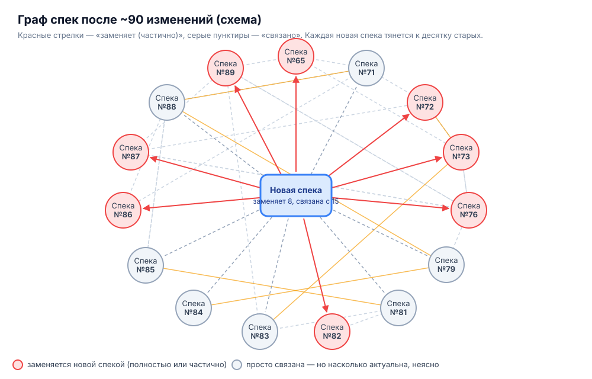

# Spec-driven development (SDLC): плюсы и цена

> **SDD умер.** Те, кто продолжит, умрут под тоннами разъехавшихся спек. Вместо него будет ??? → PROFIT.

Эта заметка — продолжение [вводной про уровни автоматизации](2026-10-24-введение-уровни-автоматизации.md) и разбор **уровня 5** («Агентные воркфлоу»). Spec-driven development — самая зрелая форма этого уровня: исполняемые спеки, верификация, тесты, петли обратной связи, осознанный human in the loop. Именно сюда сейчас добирается основная масса тех, кто активно работает с агентами, и именно здесь этот подход упирается в свой потолок.

## Плюсы

- Высокая степень автономности: агент долго работает по спеке без вмешательства человека.
- Требования формулируются чётче и лучше соблюдаются.
- Лучше покрытие тестами.
- Выше качество итогового результата.

## Минусы

- Долго.
- Дорого (токены, время на ревью спек).
- Каждая следующая спека обрастает историей предыдущих (см. ниже).

## Главная проблема: спеки образуют запутанный граф

Каждое изменение полностью или частично заменяет предыдущие. В итоге:

- Спеки становятся сложно связанной, неанализируемой путаницей: чтобы понять текущее поведение, нужно собирать его из десятков документов с отношениями «заменяет частично».
- Это значительно затрудняет разработку: человеку неясно, что из написанного актуально.
- Путает агентов: они читают спеки разной степени устаревшести и выбирают не ту.
- Засоряется контекст: конфликты и нестыковки между спеками и между спеками и кодом едят окно и приводят к ошибкам.
- Код и спеки расходятся, и «источник истины» размывается.

## Как выглядит путаница

Схема (обезличено): новая спека не просто добавляет требования, а переопределяет куски десятка старых. Старые при этом не удаляются и остаются в репозитории вместе с кодом, который местами уже им не соответствует.

Реальный пример: шапка одной из последних спек. Одна только шапка уже требует разбираться в 15 других документах:

> Статус: Proposed. Дата: 2026-10-24. Заменяет: N/A. После принятия частично заменяет ADR-065, ADR-072, ADR-073, ADR-076, ADR-082, ADR-086, ADR-087 и ADR-089 (см. «Влияние на существующие ADR»). Связано: changes/agent-core-option-c/ (RUN_ID 7ee06d00), changes/agent-core-v3-decision/research.md, ADR-071, ADR-079, ADR-081, ADR-083, ADR-084, ADR-085, ADR-087, ADR-088

Масштаб: в `docs/adr` сейчас около 90 ADR, и в 86 из них встречается слово «заменяет» или supersede (грубая оценка по поиску).

## SDD умер

На шкале из [вводной заметки](2026-10-24-введение-уровни-автоматизации.md):

- **Уровень 4** — MCP, скиллы, память. Агент помогает, процесс ведёт человек.
- **Уровень 5** — агентные воркфлоу, и SDD как их вершина. Полгода назад это был правильный ответ. Сегодня здесь находится основная масса, и здесь же она застревает: каждое следующее изменение дороже предыдущего, потому что тянет за собой весь граф старых спек.
- **Дальше** — ??? → PROFIT.

На современных моделях, даже китайских, SDD уже не лучший способ вести разработку с агентами: появился более эффективный подход. Кто продолжит наращивать спеки, рано или поздно утонет в них — разработка встанет не из-за модели, а из-за собственной документации.

Какой подход приходит на смену — TBD.
