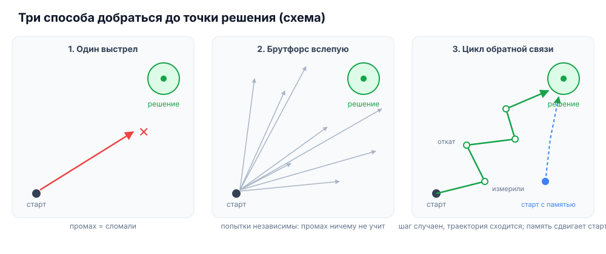
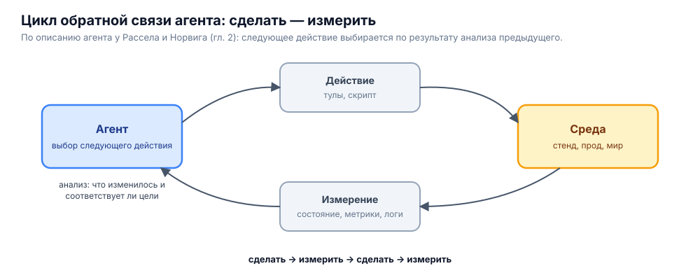
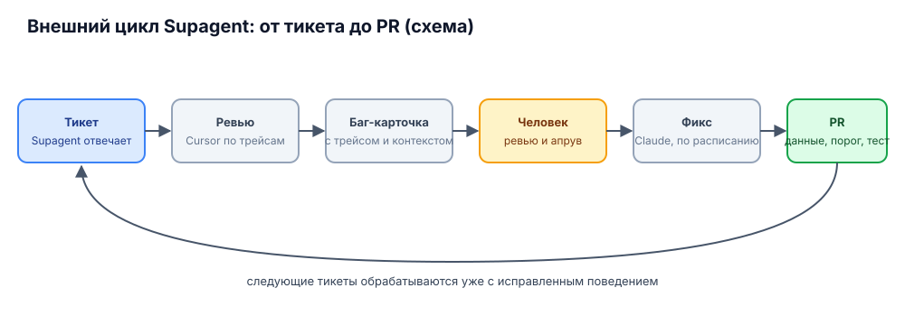

# Страх стохастичности и цикл обратной связи

Продолжение [вводной про уровни автоматизации](2026-10-24-введение-уровни-автоматизации.md), раздел про три барьера и в особенности про безопасность и «долго и непредсказуемо». Здесь развеиваю главный страх: в инфра-опс, в разработке и где угодно ещё мы боимся применять ИИ.

## Откуда страх

В самой нейросети нет знания, как правильно решить конкретную задачу. Это недетерминированная стохастическая система, и как она себя поведёт, заранее непонятно. Даже если нужное знание где-то записано в весах, нет гарантии, что именно этот вызов его выдаст: результаты разные, хотя модель и склоняется к чему-то среднему. Особенно когда это серия вызовов, как у агента: это рандом, и корректное исполнение гарантировать нельзя.

## Как это себе представляют

Многие видят это как **одну попытку**. Например, в инфра-опс: пересобрать драйвер, ядро, PHP, модуль или конфиг для nginx — что угодно. Агенту дают один шанс, он запускается и, конечно, всё ломает. Страшно, так делать не будем.

## Как это делают на практике

У тех, кто реально извлекает из этого пользу, подход не straightforward, не в лоб. Магии нет и всё не бесплатно: речь не о чудесном применении, где агент что-то делает по одной кнопке. «Одна кнопка, рандомный прогон, всё сломалось» — как раз то, чего боятся, и так это действительно не работает. В основе два компонента.

### 1. Тестовая среда

Это основа всего. В неё нужно вложиться в разработку — это отдельный аспект. Варианты:

- тестовый стенд, имитирующий прод или stage;
- обвязка на моках и фикстурах;
- для самых смелых — прод.

### 2. Накат и откат изменений, как можно более гранулярные

Пример: изменение одного параметра в конфигурации PostgreSQL. Простой скрипт применяет параметр, точно такой же откатывает. Даже в проде: агент что-то изменил, метрика ушла в красный диапазон — откат вызывает автоматика, а не агент. Умная модель, и даже не самая умная, справилась бы сама: поняла бы и откатила, практически гарантированно — 99,9 и сколько-то девяток после запятой. Но зачем тратить токены, если детерминированный скрипт даёт 100%. Автоматика откатывает, агент получает уведомление как event и продолжает работать, уже скорректировавшись.

Так в проде одновременно получается и тестовая среда, и цикл обратной связи: агент может корректировать свои решения.

Самый простой случай изменения на проде — инцидент. Запускаем агента чинить, и он, понятно, может сделать ещё хуже — этого и боимся. Поэтому он снимает бэкап и правит; если стало хуже, возвращает бэкап. Таких процедур много: обслуживание, обработка инцидентов и так далее.

## Брутфорс как приближение к решению

Из цикла обратной связи вытекает возможность для агента **брутфорсить**: методом перебора находить правильное решение. Готового решения для конкретного кейса и конкретной среды в модели нет, но есть знание о примерном направлении. Когда ей говорят «обнови версию MySQL на сервере», она не начинает смотреть прогноз погоды. Она знает, что нужно подключиться к серверу, примерно знает, какие адреса у сокетов; они могут отличаться в зависимости от версии операционной системы — здесь она может споткнуться. Но споткнувшись один раз, корректируется.

Она знает направление примерно: отклонилась сначала на три градуса, получила фидбэк в петле обратной связи, скорректировала на один градус — и маршрут стал вернее, ближе к цели. Так шаг за шагом, брутфорсом, за сколько-то итераций. Сколько именно — зависит от того, насколько умна модель, насколько в весах заложено правильное решение и понимание контекста задачи, насколько хорошо сформулированы скиллы, то, что подмешивается в prompt, guardrails, детерминированные вспомогательные тулы — то есть **от среды**. Но агент придёт к решению.

### Память сдвигает точку старта

Один раз придя к решению, агент может не потерять путь. Если заранее обеспечить запись успешных трасс — через инструкции в prompt, через хуки или просто через shell, который ведёт лог успешно завершившихся команд, — это формирует память. В следующий раз на этой же или подобной задаче начинать приходится уже не с далёкой точки, из которой нужно искать маршрут брутфорсом, а из более близкой к цели. Начальная точка последующих задач благодаря памяти ближе к решению.

### Не обязательно умная модель

По этому принципу — среда, которая одновременно защищает прод (изолированный stage либо система в проде, которая сразу откатывает ошибки) и замыкает цикл обратной связи, — даже не самые умные модели, вроде DeepSeek или Grok 4.7, находят решения достаточно сложных инфраструктурных задач: компиляция компонентов и целых модулей ядра, перебор разных флагов компиляции, скачивание нужных пакетов и заголовков, правка констант в самих заголовках, что угодно.

## Зачем агенты, если есть классическая автоматика

Закономерный вопрос: зачем делать агентов на то, что можно обложить классической автоматикой — контроллеры на Go для Kubernetes, скрипты на bash или Python для управления Linux, Terraform и тому подобное. Можно. Но это дороже по времени и требует больше вложений и человеко-часов. Писать все эти спеки, Terraform, код на Go и скрипты можно с агентами, и нужно, — так делают все.

Дело в том, что когда ты пишешь код, ты пишешь его в отрыве от реальной инфры: идёшь классическим путём из DevOps, мыслишь старыми паттернами. Я говорю о другом: нужно изменить подход к мышлению. Старые парадигмы отбросить, изменить, дополнить, трансформировать. Не бояться новых подходов, мыслить по-новому, и не только из страха, что что-то сломается. Человеческий фактор здесь играет очень важную роль: это отдельный вопрос на стыке психологии, технологий, кибернетики и менеджмента. Мой материал — не об этом.

### Сразу агент и скилл

Как показала практика, эффективные агенты — это общие агенты с одним тулом: «исполнить произвольный Python-скрипт». С ограничениями: хуки, детерминированные обёртки для Python, self-evaluation — этим же агентом или другим, мультиагентная система из двух. Суть не в этом.

Суть в том, что **артефакты прогона агента при решении задачи — скрипты**. Не нужно по-старому проектировать, как оно будет работать, — такие описания всегда оторваны от реальности. Сделать research, исследовать работу системы по коду и документам, сопоставить логические сценарии, нарисовать, отревьюить, внести правки, реализовать, понять, что ошибся в десяти местах, сделать ADR номер два, который суперсидит первый, заново имплементировать — это для дедов, которые медленно напердят. Сейчас запускаешь агента, и артефактом прогона уже скрипты. Не идеальные, говнокод, кривые. Но кто их будет читать? Кто сейчас читает сам код?

Не нужно привязываться к старым концепциям: красивый код, читаемость, ревьюбельность — нахер всё. Должно работать, и работать быстро и дёшево. Бизнес выберет именно это — при прочих равных, при такой же надёжности, а её можно обеспечить. Основная работа здесь именно в этой плоскости, а не в проектировании и написании кода, как в традиционных подходах. Трудозатраты смещаются в смежную область, но там они меньше: внимание разработчика и инженера перемещается, всё остальное автоматизируется.

Первый прогон — первая версия скрипта, второй прогон — исправленная. Human in the loop смотрит, направляет, ревьюит, вносит правки. Речь пока не о стопроцентно автономной работе, а о снижении требований к человеко-часам и вниманию людей и об ускорении самой разработки и цикла поставки.

## Цикл обратной связи

Питер Норвиг в книге «Искусственный интеллект: современный подход» (ей уже лет сорок, наверное) видит суть агента в цикле обратной связи. Агент что-то делает с помощью инструмента, снова считывает состояние окружающей среды, мира, анализирует, как его действие повлияло на мир и соответствует ли оно цели, и следующее действие выбирает уже на основе этого анализа. Постоянно, в цикле: сделать-измерить, сделать-измерить.

Брутфорс из предыдущего раздела — это и есть этот цикл, развёрнутый во времени: шаг, измерение, поправка, следующий шаг.

### Внутренний и внешний цикл

Этот цикл применим не только в работе самого агента. В процессе разработки его тоже можно выстроить автономно. Я называю это **внешним циклом**: внутренний цикл — в самом агенте, а внешний включает репозиторий, production-среду и людей — разработчиков и инженеров, которые это всё супервайзят.

В Supagent это устроено так. Он работает, отвечает на тикеты, и каждый тикет ревьюит ещё один агент — кодинг-агент общего назначения, по факту Cursor. Он оценивает ответ и все шаги по трейсам. Для этого очень важны traceability, организованные логи, схемы, по которым логи пишутся, знания и тулы для анализа — чтобы всё работало чётко, с минимальными затратами и максимально быстро.

На основе этого он находит баги и неточности и автоматически открывает баг-карточки. Человек эти карточки ревьюит. К ним прикреплён весь контекст: конкретный чат, трейс самого Cursor, ссылка на тикет, описание ошибки, возможно, ссылки на код — у Cursor есть доступ к коду, и он может оценить, где ошибка произошла. Затем подтверждённые человеком баги по расписанию, например каждую полночь, забирает на фикс кодинг-агент Claude.

Как правило, баги мелкие и фиксятся быстро, без сложных воркфлоу: всё просто чинится, готовится PR. Часто это правки в данных: в память попала кривая, неверная формулировка. Или можно подкрутить параметр, например threshold для реранкера; поднять reasoning у gate-модели; если на входе стоит decision-модель, которая классифицирует, — добавить в неё новый кейс. Это мелкие точечные правки, от которых можно устать, если делать руками. Всё это невозможно было предусмотреть на этапе проектирования, но в процессе, на каждом тикете, мы замечаем мелкие отклонения и подтюниваем, подкручиваем поведение — именно в таком автоматическом цикле обратной связи, выстроенном вокруг репозитория с кодом и вокруг прода.
