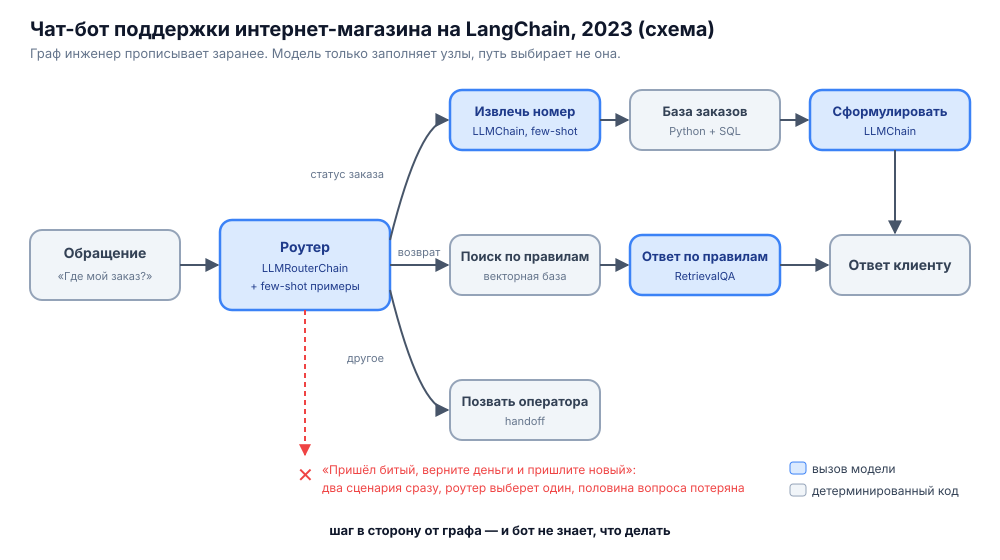
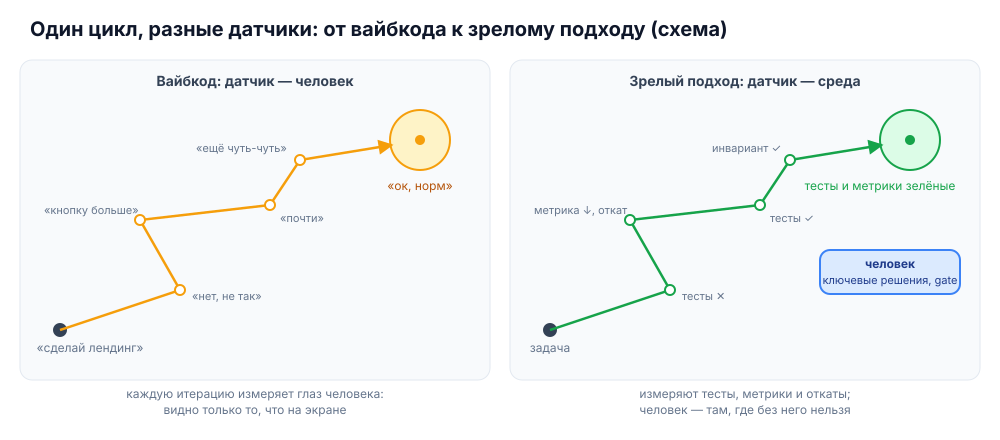

# Вайбкод — это смерть?

Черновик доклада на пятницу, 6 ноября. Провокационный ответ на доклад коллеги «Вайбкод — это жизнь?». О чём: ограничения вайбкода, зрелые подходы и где они уже работают — в разработке и за её пределами: инфра-опс, личный ассистент, саппорт.

Коллега спросил, жизнь ли это. Я отвечу: **смерть**. Причём тройная: мозга, кошелька и проекта. А в конце расскажу, есть ли жизнь после смерти. Спойлер: есть, но в неё не попадают просто так, по вайбу.

## 1. Как возникло явление

Сначала агентов не было. Была генерация кода: жмёшь Tab, и модель дописывает строчку. Сам Tab, кстати, не новость: IntelliSense от Microsoft подсказывал по нему ещё в Visual Studio 2010, а появился и вовсе в 1996-м. Только IntelliSense подставлял имена из проекта, а модель дописывает код по смыслу. Затем инлайн-команды: выделяешь функцию, пишешь «перепиши без цикла», получаешь диф. Или копируешь куски из чата туда и обратно. **Программировал всё ещё человек**, модель была умным автокомплитом.

Параллельно в чате мы освоили **few-shot**. Это когда модели не объясняешь задачу правилами, а показываешь несколько примеров «вход → выход» прямо в промпте, и она продолжает по образцу. Термин пришёл из пейпера про GPT-3 2020 года, «Language Models are Few-Shot Learners». Работало это так: вставляешь в чат три обращения клиентов с готовой разметкой «доставка», «возврат», «оплата», и четвёртое модель размечает сама. Или даёшь пару образцов ответа в нужном тоне и формате и получаешь третий такой же. **Без примеров модель отвечала как попало, с примерами — предсказуемо.**

Второй приём из чата — **цепочки вызовов**. Большую задачу режешь на шаги, и выход одного вызова становится входом следующего: сначала вытащить из письма номер заказа, потом сходить с ним в базу, потом сформулировать ответ. В чате это делалось руками: скопировал результат, вставил в следующее сообщение, добавил инструкцию.

Первые агенты — это ровно эти два приёма, переложенные в код. Появились они почти одновременно с ChatGPT, в конце 2022-го. Пейпер ReAct в октябре показал, что модель может чередовать рассуждение и действие, и учили её этому тоже few-shot: в промпт вставляли пару образцов трасс «мысль → действие → наблюдение». LangChain вышел в том же октябре, за месяц до ChatGPT, и упаковал всё это в библиотеку: шаблоны промптов с примерами, цепочки вызовов, роутеры между ними. В декабре туда добавили агентов на основе ReAct, а в марте 2023-го вышел AutoGPT.

Так началась эра LangChain и подобных: инженер прописывает flow, агент решает одну специфическую задачу. **Я бы назвал таких агентов жёсткими, ригидными**: они подчиняются детерминированному сценарию по графу, а модель только заполняет узлы. Типичный пример — чат-бот поддержки интернет-магазина образца 2023 года. Роутер с few-shot примерами решает, куда отправить обращение. Для статуса заказа одна цепочка вытаскивает номер, обычный код идёт в базу, вторая цепочка формулирует ответ. Для возврата — поиск по базе правил и ответ по найденному. Всё остальное уходит оператору.

Пока клиент спрашивает по сценарию, всё работает. Но обращение «пришёл битый, верните деньги и пришлите новый» — это два сценария сразу, а роутер выберет один. **Половина вопроса теряется, и граф ничего не может с этим сделать**: пути, которого инженер не нарисовал, для бота не существует.

Потом появились агенты другого типа. Они сами читают проект, правят файлы, запускают команды и смотрят на ошибки. Сценария больше нет: путь агент выбирает сам. И случился сдвиг: прототип, который худо-бедно работает, можно собрать **без технической спеки, без архитектуры, без SDLC**. Просто накидываешь агенту свой вайб на естественном языке: «сделай красиво», «нет, не так», «ну вот, почти».

Здесь важно зафиксировать один момент. **В вайбкоде human in the loop работает как элемент обратной связи.** Каждое «нет, не так» — это измерение, и по нему агент шаг за шагом приближает решение к желаемому. Это тот же цикл, что у агентов, которые [брутфорсят решение с обратной связью](2026-10-27-страх-стохастичности-и-цикл-обратной-связи.md#брутфорс-как-приближение-к-решению) без человека. Только датчиком в нём работает человек.

**Зрелые подходы — это эволюция из вайбкода, а не его отрицание.** Цикл остаётся, меняется датчик: вместо глаза человека — тесты, метрики, стенд и откаты. А сам человек уходит туда, где без него не обойтись.

В феврале 2025-го Андрей Карпатый дал этому имя: vibe coding. Отдаться вайбу и забыть, что код вообще существует. **Название появилось позже, чем само явление**: к тому моменту так уже работали многие, и я в том числе.

## 2. Моё знакомство с агентной разработкой

Фриланс был моим источником заработка ещё до агентов. Мелкие проекты для малого бизнеса, что угодно: сайты, приложения, DDoS-файрволы и фильтры, микросервисы, небольшие программы под конкретную задачу клиента. **Обычная жизнь фрилансера**: сколько успел сделать руками, столько и заработал.

Агентную разработку я прошёл целиком, с самого начала. **Начал с Cursor версии 0.2 летом 2023 года.** Сначала автокомплит и инлайн-команды: это всё ещё я пишу код, просто быстрее. Ощущение было как от хорошей IDE, не больше. Но буст уже огромный: очень весомая часть рутины просто отпала.

Первые агенты ощущались совсем иначе. **Я перестал писать код и начал его заказывать.** То, на что раньше уходил день, делалось за час. Не нужно проектировать, не нужно толком читать, что получилось: работает — и ладно. Это было похоже на магию, и я в неё поверил.

## 3. 2024 год: секретный взлёт

В 2024 году случился резкий взлёт. И главное в нём то, что **я был в этом один.** Про Cursor я не рассказывал никому, кроме самых достойных. Зачем раздавать конкурентам оружие, которое даёт тебе фору?

Фора была огромной: **я забирал в пять раз больше заказов, чем остальные**, и успевал их сделать. Конкурентов с такой скоростью на рынке просто не было: большинство ещё писало код руками.

Качество было так себе, и я это знал. Но вещи получались **очень рабочие**, особенно UI: интерфейсы агенты уже тогда делали классно, а заказчик видит именно интерфейс. Лендинги шли потоком, и дошло до собственного конструктора сайтов.

Конструктор собирал лендинг генерациями на GPT-3.5 Turbo (в API это `gpt-3.5-turbo`, в 2024-м под ним стоял снапшот `gpt-3.5-turbo-0125`), **максимум за 30 минут**. Продавал я их **по 10 долларов**. Копейки? Конструктор выдал под тысячу сайтов, и всё это работало **почти полностью на пассиве**.

А потом появились Bolt.new в октябре 2024-го и Lovable в ноябре, а за ними и остальные. Клиент теперь мог собрать себе лендинг сам, прямо в браузере. Пошло adoption в массы, и **моё преимущество начало таять**.

## 4. Эйфория и дешёвый дофамин

Дальше секрет окончательно перестал быть секретом. Вайбкод захлестнул всех. Лента забилась постами «сделал SaaS за выходные без единой строчки кода». **Казалось, что программировать больше не нужно**, а программисты — следующий вымирающий вид.

Механика простая и знакомая: написал промпт, нажал Enter, смотришь, выпало или нет. Не выпало — жмёшь ещё раз. **Это игровой автомат**, только вместо жетонов токены. Мгновенный результат без усилий — самый дешёвый дофамин из доступных.

При этом надо честно признать: получалось. Небольшие программы, внутренние тулзы, прототипы, иногда реально полезные бизнесу, если применить с умом. **Поделки, низкокачественные, но рабочие.** Вайбкод давал плоды. Только собирал их теперь не я один, а все.

## 5. Как вайбкод убил меня

**Вайбкод меня сначала озолотил, а потом убил.** То, что давало мне преимущество, очень быстро стало массовым. Порог входа упал до нуля. Школьники вайбкодят практически бесплатно: им не нужно на это жить, и по цене с ними не конкурировать.

Рынок рухнул. Первым умер конструктор: кто купит лендинг за 10 долларов, если Lovable соберёт его бесплатно за пять минут. Следом обесценились и остальные мелкие проекты, на которых я жил: зачем платить фрилансеру за сайт или микросервис, если «нейросеть сама сделает». **Заказы у меня просто пропали.** Не стало меньше, а именно пропали.

Уровень жизни упал. И мне, фрилансеру, который ещё вчера делал в пять раз больше всех, **пришлось идти на работу в найм.** Это и есть первая смерть, которую я пережил лично, а не в теории.

Вывод неприятный: **«быстро и низкокачественно» — не навык, а временное окно.** Пока так умеешь только ты, это преимущество. Когда так умеют все, это просто нижняя планка рынка, и стоит она копейки. Если честно, **я сам был тем школьником с вайбкодом, только на год раньше.**

## 6. Большие продукты и предел вайбкода

Второй удар пришёл с другой стороны. Лендинг живёт неделю, а большой продукт разрабатывают месяцами и годами. И тут вайбкод упирается в потолок. **Первые две недели — восторг, на третий месяц — болото.**

Репозиторий превращается в **кашу из слабо связанных документов, которые противоречат коду** и друг другу. Агент сам написал README, сам его забыл и сам ему противоречит. Каждый фикс ломает два других места, агент чинит то, что сломал вчера, контекст забит устаревшим мусором. Даже со спеками эта каша возвращается в другой форме — об этом [заметка про SDD](2026-10-26-spec-driven-development-sdlc.md).

И наступает момент, когда **агент не ускоряет разработку, а замедляет её**. Руками было бы быстрее. Только руками уже никто не может: никто не понимает, как это всё устроено. Проект не развивается, а разваливается.

## 7. Вайбкод — это смерть

На шкале из [вводной заметки](2026-10-24-введение-уровни-автоматизации.md) вайбкод — третий уровень: агентов используют на несколько процентов от их возможностей. **Делегируют агенту мышление** и дают ему бесконтрольно выполнять большие блоки задач. Это не инженерия, а слабоумие и отвага. И у неё три исхода.

**Смерть мозга.** Когда думает агент, ты перестаёшь думать сам. Сначала не читаешь код, потом не понимаешь, что он делает, потом не можешь сформулировать, чего хочешь. Остаётся палец на Enter и надежда, что в этот раз выпадет. **Отупение от дешёвого дофамина — самый тихий и самый реальный эффект.**

**Смерть от голода и бедности.** Это не метафора, я через неё прошёл: заказы пропали, уровень жизни упал, пришлось идти в найм. Если твоё умение — то, что бесплатно делает любой школьник, то и стоит оно бесплатно. На вайбкоде можно было заработать в окне 2024 года. **Сейчас на нём не заработаешь ничего, кроме выгорания.**

**Смерть проекта.** Стремительный взлёт, яркая вспышка, демо в соцсетях — и конец. Цикл обратной связи в вайбкоде есть, но **датчик в нём — глаз человека.** Он видит кнопку на экране, но не видит [тихих ошибок и отложенных эффектов](2026-10-27-страх-стохастичности-и-цикл-обратной-связи.md#где-откат-не-спасает) и архитектуры, которая расползается с каждым «почти». Поэтому UI вайбкодится отлично, а большой продукт гниёт изнутри. На коротком отрезке глаза хватает, на длинном ошибки накапливаются, и дальше вайбкода проект не двинется.

Нагляднее всего это видно на ботах в саппорте. Собрать такого по вайбу можно за вечер, и выглядят они все одинаково: **выдумывают факты, теряют вопрос из длинного запроса, не имеют доступа к данным и всё время зовут человека.** Демо прошло отлично, а в проде бот только раздражает клиентов.

## 8. Агент как инструмент

Двигало меня не любопытство и не любовь к красивой инженерии. **Двигал в первую очередь страх голода и бедности.** Когда заказы пропадают, быстро понимаешь: либо учишься делать то, что школьник с вайбкодом не сделает, либо остаёшься на нижней планке рынка.

Пришлось подключить голову. И признать простую вещь: **агент — не магия, а инструмент.** Сложный, уровня фотошопа или автокада. Никто не ждёт, что кто-то откроет автокад в первый раз и вечером спроектирует мост.

Дальше классический путь освоения инструмента. Изучать техники и методы, разбираться, какие есть функции, пробовать, совмещать, набивать шишки. Перепробовать весь спектр: от голого Claude до n8n, LangChain и собственного supagent. **MCP, скиллы, память, хуки, контекст-инжиниринг** — это четвёртый уровень. Тестовая среда, верификация, петли обратной связи, осознанный human in the loop — пятый.

И отдельно пришлось переучиться думать. Агента нельзя прикрутить надстройкой к старому процессу и ждать чуда. **Процесс нужно сразу строить AI-native**, с агентом внутри, а не сбоку.

Скучно? Да. Дофамина меньше? Намного. **Но именно здесь агент начинает ускорять разработку на длинной дистанции, а не только на первой неделе.**

## 9. Есть ли жизнь после смерти

Есть. Это **AI-assisted разработка**. И вот главный парадокс: код у меня и сейчас кривой, и я его почти не читаю. Говнокод, как и раньше. **Разница не в коде.**

Разница в том, что вокруг него. Вайбкод держится на глазе человека и везении, AI-assisted разработка — на **доверии, основанном на тактике и проверках**. Как точно сформулировал Рефат в [своём посте](https://t.me/nobilix/277), **доверие — свойство системы, а не модели.** Модели не нужно верить на слово: нужна система, в которой её ошибка ничего не ломает.

Датчиком в цикле становится не глаз человека, а среда: **стенд и откат**. Пример: агент меняет параметр в конфиге PostgreSQL. Один простой скрипт его накатывает, такой же простой откатывает. Метрика ушла в красную зону — **откатывает автоматика, а не модель.** На проде перед любой правкой — сначала бэкап.

Это цикл обратной связи, который Рассел и Норвиг описали ещё в 1995-м: сделать, измерить, снова сделать. Каждая попытка опирается на результат предыдущей, а не на удачу. Подробно — в [заметке про стохастичность](2026-10-27-страх-стохастичности-и-цикл-обратной-связи.md).

Мышление при этом другое. Вместо того чтобы заранее писать Terraform и спеки в отрыве от реальной инфраструктуры, я даю агенту **один тул: исполнить Python-скрипт**. Артефакт прогона — это и есть скрипты, уже проверенные на живой среде. Так быстрее. И если стоят хуки и границы тулов, **за почти год работы в инфраструктуре агенты ошибаются реже, чем я руками.**

Реальный пример — supagent. Он отвечает на тикеты, каждый тикет по трейсам ревьюит Cursor, найденные баги автоматически становятся карточками, человек их подтверждает, а ночью их забирает на фикс Claude. **Агенты пишут почти всё, но ничего не происходит по вайбу.** Внимание инженера ушло из написания кода в среду, верификацию и супервайзинг.

Так я теперь работаю везде, где раньше было страшно пускать агента: **инфра-опс, саппорт, личный ассистент.** Пример задачи для ассистента — расчёт окупаемости собственного GPU под инференс 70B-модели. Это уже не поделки на один вечер, а системы, которые живут и развиваются.

Вайбкод — это смерть. **Жизнь после неё начинается, когда снова включаешь голову.**
