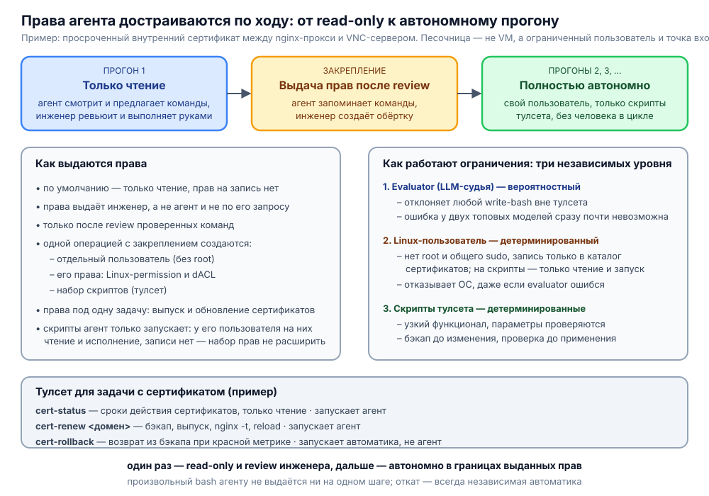

# Права агента достраиваются по ходу: кейс с просроченным сертификатом

**Пример безопасного и экономически выгодного применения агентов в проде — на реальном кейсе.**

Кейс к теме [«Страх стохастичности и цикл обратной связи»](2026-10-27-страх-стохастичности-и-цикл-обратной-связи.md) и к докладу про [агента в проде](2026-11-07-агент-в-проде-текст-выступления.md). Там речь о среде и цикле обратной связи, здесь — о том, как у агента появляются полномочия: не выдаются заранее «на всякий случай», а выстраиваются по мере выполнения задачи, чтобы дальше агент работал автономно.

## Инцидент

Служебный внутренний SSL-сертификат для связи между компонентами системы: по факту это nginx-прокси и VNC-сервер для подключения к терминалам виртуальных машин. Сертификат забыли обновить, и это привело к инциденту.



## Прогон 1: только чтение

Агента пускаем на сервер в режиме **read-only**. Он ничего не меняет, только смотрит, что происходит на сервере.

### Как обеспечивается read-only

Агент ходит на сервер через bash, и read-only держится на **auto mode evaluator**: он отклоняет любую команду, которая что-то пишет. Судит не список запрещённых слов, а LLM: она смотрит на каждую команду и решает, читает та или пишет. Получается связка из двух сильных моделей: одна генерирует команды, вторая их проверяет.

Остаточный риск у такой схемы есть, но в современных реалиях он минимальный. Сильные модели ошибаются редко, а ошибка должна случиться сразу у двух: и у той, что генерирует команду, и у той, что её судит. На нынешнем уровне развития топовых моделей, даже китайских, это практически невозможно. Страшилки про `rm -rf /` — это мемы, откуда-то из 2024 года. *Мы все любим мемы, но не надо принимать их близко к сердцу: так мем становится мифом. (Пытаюсь стендапить.)* За почти год практики я ни разу не видел, чтобы агент попытался выполнить по-настоящему страшную команду и её пришлось отклонять. Возможно, какая-то и проскакивала, но ничего деструктивного не случалось.

### Что происходит в этом прогоне

1. Агент предлагает команды для решения инцидента.
2. Инженер ревьюит эти команды.
3. Если всё в порядке, инженер выполняет их руками.

Агент сам ничего не применяет. Инцидент решает инженер, а агент в этот момент работает как человек, которому подсказывают нужные команды.

## Закрепление: как выдаются права

Права не выдаются заранее и не выдаются агенту по его просьбе. Их выдаёт инженер, и только в одной точке: когда ревью пройдено.

1. Агент **запоминает** проверенные инженером команды.
2. Вместе с ними инженер сразу выполняет отдельные команды, которые создают для агента **обёртку**: отдельного пользователя, права этого пользователя и набор скриптов.
3. Обёртка делается под одну задачу: выпуск и обновление сертификатов. Больше ни на что у агента прав нет.
4. Скрипты агент может только запускать. Системный пользователь, под которым он заходит на сервер, не имеет прав на запись в файлы скриптов: у него есть только чтение и исполнение. Изменить скрипт он не может, а значит, не может и расширить набор того, что ему разрешено: этот набор целиком задан скриптами.

Так право появляется ровно там, где человек уже проверил, что именно агент делает.

## Песочница: ограниченный пользователь и ограниченная точка входа

Это не виртуальная машина и не контейнер. Песочница здесь — **ограниченный пользователь на самом сервере и ограниченная точка входа**: единственное, что этому пользователю доступно, — заранее подготовленный набор скриптов. Ограничения работают на трёх независимых уровнях, и у каждого своя природа гарантии.

**1. Evaluator — вероятностный уровень.**
Любую команду агента судит LLM. Всё, что похоже на запись и не является вызовом скрипта из набора, отклоняется. Риск ошибки формально есть, но нужно, чтобы ошиблись сразу генератор и судья, а на нынешнем уровне топовых моделей, даже китайских, это практически невозможно.

**2. Linux-пользователь — детерминированный уровень.**
Отдельный пользователь без root и без общего sudo. Стандартные Linux-permission и dACL дают ему запись только в каталог с сертификатами и запуск скриптов набора. На сами файлы скриптов у него нет права записи, только чтение и исполнение. Если evaluator всё же пропустит что-то лишнее, откажет сама операционная система, а не модель.

**3. Набор скриптов — детерминированный уровень.**
Вместо произвольного bash у агента есть тулсет: скрипты с узким функционалом. Они принимают минимум параметров и сами их проверяют, сами снимают бэкап перед изменением и сами проверяют результат. Агент выбирает, какой скрипт вызвать и с какими параметрами, но не придумывает команды.

Поэтому ошибка на одном уровне не превращается в инцидент: её ловит следующий. Первый уровень вероятностный, но два других от модели не зависят.

## Примеры скриптов тулсета

Набор для этой задачи небольшой:

| Скрипт | Что делает | Кто запускает |
|---|---|---|
| `cert-status` | показывает сроки действия сертификатов компонентов, только чтение | агент |
| `cert-renew <домен>` | выпускает и устанавливает сертификат, перезагружает nginx | агент |
| `cert-rollback` | возвращает предыдущий сертификат из бэкапа | автоматика |

Скрипт `cert-renew` выглядит примерно так (рабочие имена и пути обезличены):

```bash
#!/usr/bin/env bash
# Единственный параметр — имя домена; другие значения скрипт не принимает.
set -euo pipefail

domain="${1:?нужно имя домена}"
[[ "$domain" =~ ^[a-z0-9-]+(\.[a-z0-9-]+)*\.internal$ ]] || { echo "недопустимое имя: $domain" >&2; exit 2; }

dir=/etc/ssl/internal
stamp="$(date +%s)"

# 1. Бэкап текущего сертификата, чтобы откат был возможен
mkdir -p "$dir/backup/$stamp"
cp -a "$dir/current/." "$dir/backup/$stamp/"
echo "$stamp" > "$dir/backup/last"

# 2. Выпуск и проверка нового сертификата
issue-internal-cert "$domain" --out "$dir/new"
openssl x509 -in "$dir/new/$domain.crt" -noout -checkend 86400

# 3. Установка и проверка конфигурации до применения
cp -a "$dir/new/." "$dir/current/"
if ! nginx -t; then
  cp -a "$dir/backup/$stamp/." "$dir/current/"   # ещё ничего не применено, возвращаем как было
  exit 1
fi

# 4. Применение
systemctl reload nginx
```

Скрипт откатывается сам только на том этапе, где проверка конфигурации ещё до применения: пока ничего не заработало с новым сертификатом, вернуть прежний можно локально. Дальше начинается другая история.

### Откат после применения

После `reload` скрипту уже нечего проверить изнутри: работает ли консоль VNC с новым сертификатом, видно только по метрике снаружи. Поэтому откат после применения выполняет не агент и не сам скрипт, а **автоматика, которая реагирует на красную метрику**: так же, как описано в заметке про [цикл обратной связи](2026-10-27-страх-стохастичности-и-цикл-обратной-связи.md). Метрика доступности подключений к терминалам ушла в красное — автоматика запускает `cert-rollback`:

```bash
#!/usr/bin/env bash
# Возвращает сертификат из последнего бэкапа. Запускается автоматикой, не агентом.
set -euo pipefail

dir=/etc/ssl/internal
last="$(cat "$dir/backup/last")"

cp -a "$dir/backup/$last/." "$dir/current/"
nginx -t
systemctl reload nginx
```

Откат запускает детерминированная автоматика: быстро, предсказуемо и без токенов. Агент получает событие, что его изменение откатили, учитывает это и пробует другой подход. Права на запуск `cert-rollback` у агента нет, поэтому откат остаётся независимой страховкой, а не ещё одним действием модели.

## Следующие прогоны: автономно

Следующий прогон полностью автономный. Агент работает под своим пользователем в рамках своего тулсета, и инженер в процессе не участвует.

Получается, что **один раз, в ключевой момент, агент работает в read-only, инженер делает review, всё закрепляется — и дальше работа идёт без человека.**

## Чем это отличается от скрипта

Внешне это похоже на классический скриптинг: прошли задачу, сохранили команды, потом гоняем их автоматически. Но есть два отличия.

Первое — не нужно самому писать все скрипты и отлаживать их до совершенства.

Второе — гибкость. В жёстком скрипте любой нелинейный случай приводит к ошибке. Агент в рамках своих полномочий может немного отойти от заданного сценария. Например, добавили поддержку нового домена, а в скрипте забыли его указать. Агент в следующем проходе видит, что нужно поменять один параметр: вызвать `cert-renew` с другим именем домена. Это не выходит за его права, но решает проблему — и новый домен подхватывается автоматически, без правки скрипта.

Границы при этом не размываются: гибкость агента ограничена теми же правами пользователя и теми же скриптами. Отойти от сценария он может, выйти за свои полномочия — нет.

## Где экономятся человеко-часы

Именно здесь, в этих двух отличиях, и лежит главная экономия для бизнеса.

Скрипт, который нужно довести до совершенства, — это человеко-часы инженера: предусмотреть все случаи, отладить, дописать при каждом новом домене или нестандартной ситуации. Агент, который гибко решает нелинейные случаи сам, эти часы снимает. Там, где жёсткий скрипт упал бы и пошёл в эскалацию, агент разбирается в рамках своих полномочий и доделывает работу сам.

Поэтому в таком прогоне **не требуется ни эскалация, ни участие поддержки**: ни инженер, которого поднимают на упавший скрипт, ни дежурный, который чинит то, что забыли учесть. Это та точка, где человеческое время реально превращается в сэкономленное, а не просто перераспределяется.

## Как это связано с supagent

Всё, что описано выше — read-only, evaluator, ограниченный пользователь, тулсет, обёртка, откат автоматикой, — относится к **кодинг-агенту общего назначения**: Codex, Claude Code, Cursor, OpenCode и им подобным. Это он заходит на сервер, смотрит, предлагает команды и потом автономно работает в своих границах.

У supagent с ним связь такая: supagent имеет интерфейс, через который может вызвать этого агента, передать ему задание и получить результат обратно. Работает это по протоколу **A2A**.
