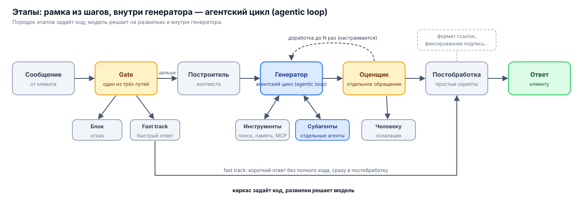
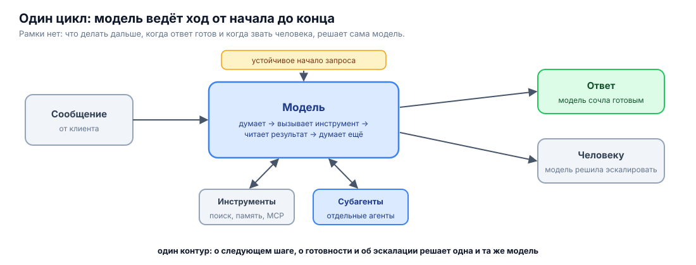
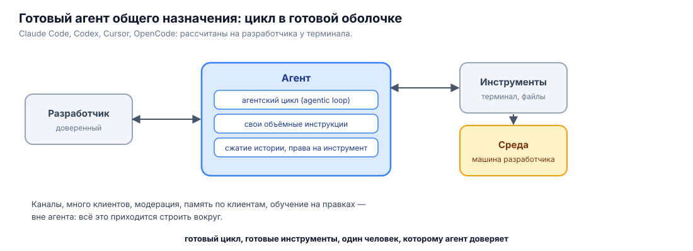

# Этапы, один цикл или готовый агент

Фрагмент для доклада. Черновик.

## «Зачем столько этапов, если есть Claude Code?»

Этот вопрос мне задают чаще всего. Модели сильные, готовые агенты — Claude Code, Codex, Cursor, OpenCode — умеют сами вести агентский цикл (agentic loop), искать, думать, проверять себя. Зачем вокруг этого строить рамку из этапов, если можно взять один цикл и отпустить его?

Чтобы ответить честно, сначала посмотрим, как устроена каждая из трёх схем. Потом сравним.

## Три способа устроить обвязку агента

### Этапы

Ход разбит на шаги, порядок которых задан кодом. Gate выбирает один из трёх путей: заблокировать сообщение, ответить коротко через fast track или пустить дальше в полный ход. Построитель контекста собирает память, правила и историю. Генератор пишет черновик: внутри него модель свободна, сама выбирает, какие инструменты вызывать и сколько раз, и может передать часть работы субагентам. Оценщик отдельным обращением к модели принимает черновик, возвращает на доработку — число доработок настраивается — или передаёт человеку. Постобработка оформляет ответ простыми детерминированными скриптами: формат ссылок, фиксированная подпись и тому подобное. Модель решает на развилках и внутри генератора, поэтому это не строгий конвейер, а гибрид — агентский цикл (agentic loop) внутри рамки из кода. Иначе говоря, это тот же агентский цикл, у которого часть правил хода вынесена в код: чтобы они выполнялись гарантированно, были наблюдаемы, тестируемы и конфигурируемы.

Плюсы:

- **Обязательные шаги гарантирует код.** То, что должно выполняться всегда — смотреть память, проверять ответ, применять правила, — выполняется кодом на каждом ходе, а не по просьбе в промпте. Заранее не узнать, что вспоминать нечего, поэтому такие шаги нельзя оставлять на усмотрение модели.
- **Проверку делает не тот, кто писал ответ.** Решение о готовности принимает отдельный вызов в другом контексте, со своей инструкцией и, по настройкам, другой моделью. Это эквивалент того, что один агент проверяет другого.
- **Свой вход у каждой функции.** Каждый этап получает не общий контекст хода, а то, что нужно именно ему: оценщик — черновик и свидетельства, а не всю цепочку вызовов инструментов. Короткий вход дешевле, быстрее читается и лучше обрабатывается.
- **Своя модель у каждой функции.** Короткий вход этапа можно отдать дешёвой модели. Gate маршрутизирует и по модели: простые обращения, для которых есть память или готовые ответы, — на простую, сложные — на мощную. Оценщик при доработке переходит на модель сильнее. Умная модель платится только там, где она нужна.
- **Нативная трасса.** Обвязка пишет трассу сама, в формате, удобном ей: каждое решение, вход и выход этапа, токены и стоимость. Её удобно разбирать человеку вручную и агенту второго контура, который анализирует работу ядра.
- **Решения тестируются по отдельности.** Выбор пути в gate, вердикт оценщика, отбор памяти — отдельные единицы со своим входом и выходом. Их можно прогонять на наборе случаев и сравнивать по отдельности.
- **Правка локальна.** Gate слишком часто пускает простые сообщения в полный ход — правим gate. Оценщик слишком строг — правим оценщика. Остальные этапы не затрагиваются и проверяются своими тестами.

Минусы:

- **Стоимость разработки.** Своего кода больше всего: каждый этап нужно написать, протестировать и поддерживать. Новый маршрут или новый вид проверки — правка кода, а не строка в промпте.
- **Рамка под известный класс задач.** Набор этапов и развилок спроектирован под конкретную работу — у нас под поддержку. На открытых задачах, где заранее непонятно, какие шаги понадобятся, рамка мешает, и там лучше работает агент без неё. Поэтому открытые задачи мы отдаём агенту общего назначения во втором контуре.

### Один цикл

Рамки нет. Модель получает запрос с инструкциями и знаниями в начале, вызывает инструменты, читает результаты и думает дальше — пока сама не сочтёт ответ готовым. Поиск, память, действия и субагенты оформлены как инструменты, которые модель зовёт, когда считает нужным. Что делать дальше, когда остановиться и когда передать разговор человеку, решает одна и та же модель. Начало запроса остаётся устойчивым от хода к ходу и хорошо кэшируется.

Плюсы:

- **Стоимость разработки.** Кода и стыков меньше: один цикл, всё остальное — инструменты.
- **Нативная трасса.** Как и у этапов, обвязка пишет трассу сама, в удобном ей формате. Её удобно разбирать человеку и агенту второго контура.
- **Гибкость.** Заданных развилок нет, модель может сделать любой шаг в любой момент. На открытых и нестандартных задачах это сильнее рамки.

Минусы:

- **Обязательные шаги и проверка держатся на промпте.** Требование «всегда смотри память» или «проверь себя» записывается в инструкцию, и модель выполнит его не на каждом ходе. «Сам счёл готовым» — самая слабая проверка: модель оценивает черновик в том же контексте, с теми же слепыми пятнами. Гарантировать это можно только кодом вокруг цикла, то есть перейдя к гибриду.
- **Один контекст на все функции.** Маршрутизация, поиск, отбор, проверка — всё читает общий контекст хода и делает одна модель. Сжатие истории ограничивает рост, но не даёт функции своего короткого входа. Поставить на функцию дешёвую модель можно только вынеся её в субагента — то есть в отдельный этап.
- **Решения не выделены.** Выбор пути, отбор памяти, оценка готовности растворены в рассуждениях. Трассировать каждый вызов просто, а протестировать отдельное решение можно только целым ходом. Любая правка инструкции влияет на весь ход сразу.
- **Зависимость от модели.** Всё качество держится на рассуждениях одной модели; на дешёвой модели оно падает быстрее, чем там, где часть правил держит код.

### Готовый агент общего назначения

Это тот же цикл, но в готовой оболочке: Claude Code, Codex, Cursor, OpenCode. В комплекте уже есть цикл, инструменты (терминал, файлы, поиск, MCP), объёмные собственные инструкции, сжатие длинной истории и права на каждый инструмент. Рассчитан он на разработчика, который сидит за терминалом и которому агент доверяет. Всё, что нужно продукту вокруг, — каналы, много клиентов, модерацию, память по клиентам, обучение на правках — приходится строить снаружи.

Плюсы:

- **Стоимость разработки.** Агентский цикл (agentic loop), инструменты, сжатие истории и права на инструменты уже готовы, их поддерживает вендор или сообщество.
- **Гибкость и качество цикла.** Как у одного цикла, плюс цикл отлажен вендором под сильные модели. Сильная работа на открытых задачах, где заранее непонятно, что понадобится.

Минусы:

- **Всё, что у одного цикла.** Обязательные шаги и проверка на промпте, один контекст на все функции, решения не выделены. Только исправлять это приходится не в своём коде, а через хуки — те же этапы, написанные вокруг уже готового агента через неудобный интерфейс.
- **Безопасность под доверенный ввод.** Модель безопасности построена вокруг разработчика за терминалом: права на инструмент, а не на клиента, терминал и файлы в комплекте. Как агент собирает запрос и куда кладёт чужой текст, решает он сам без оглядки на то в какой роли и в каком контуре он работает.
- **Внутренности по чужим правилам.** Сжатие истории, собственные инструкции, порядок шагов — по правилам агента. Объёмные инструкции едут в каждом вызове, сводка может потерять нужное. Трассу взаимодействия с моделью получить можно: полным проксированием запросов и разбором потока, но это дополнительная инфраструктура, и разбирать приходится чужой формат. Своя обвязка пишет трассу сразу в нативном виде. Честная оговорка: многие готовые агенты — с открытым кодом, и менять его под себя можно. Но это значит вести форк и догонять быстро меняющийся оригинал. При нынешних возможностях AI-assisted разработки сделать своё под себя обычно проще, чем перестраивать чужое, и именно поэтому мы пошли этим путём.
- **Чужой график выпусков.** Поведение меняется вместе с версиями и не всегда задокументировано.

## Сравнение

Сравниваю только то, что фундаментально и не снимается небольшим улучшением. В зрелой системе любого типа будут трассировка каждого вызова, лимиты и сроки на ход, сжатие истории со скользящим окном, права, проверяемые в инструментах. Это не различия, и я их не считаю. Различием считаю то, что можно убрать только перестройкой подхода, дорого, неудобно или ценой скорости.

Почти любой фундаментальный минус одного цикла снимается одним способом — вынести правило в код. Но тогда это уже гибрид.

Спорят эти схемы о двух вещах: **кто решает, что делать дальше, и кто решает, что ответ готов.**

| | Этапы | Один цикл | Готовый агент общего назначения |
|---|---|---|---|
| Следующий шаг | модель, но на развилках, заданных кодом | модель, любой шаг в любой момент | модель, любой шаг в любой момент |
| Готовность ответа | отдельный вызов в другом контексте | сама модель в том же контексте | сама модель в том же контексте |
| Обязательные шаги (память, проверка, правила) | выполняет код на каждом ходе | промпт, исполнение не гарантировано | промпт или хуки вокруг готового агента |
| Вход функции | свой, только нужное | общий контекст хода | общий контекст по правилам агента |
| Модель под функцию | своя на каждом этапе, маршрутизация в gate | одна на основной ход, иначе — вынос в субагента | как настроено в агенте |
| Тестирование решений | каждое отдельно | только целыми ходами | только целыми ходами |
| Правка поведения | локально в этапе | инструкция влияет на весь ход | в пределах того, что агент позволяет |
| Гибкость на открытых задачах | ограничена рамкой | полная | полная |
| Зависимость от силы модели | меньше | сильная | сильная |
| Трасса и контроль над внутренностями | пишется в своём формате, полный контроль | пишется в своём формате, полный контроль | через проксирование и разбор чужого формата; менять — форком, если код открыт |
| Свой код | больше всего | меньше | меньше всего в ядре |

От одного цикла этапы отличаются в двух вещах. Во-первых, порядок и набор этапов заданы кодом, а модель выбирает внутри них. Оценщик при этом может направить генератор: вернуть черновик и дополнить его промпт указанием вроде «поищи вот это, вот это неверно». Во-вторых, готовность ответа определяет не тот, кто писал черновик. Проверка идёт отдельным вызовом, в другом контексте, с отдельной инструкцией и, если так настроено, на другой модели. Он видит итог и свидетельства, а не весь ход рассуждений генератора. По сути это то же, что когда один агент проверяет работу другого.

Этапы — не альтернатива циклу, а цикл, у которого часть правил хода вынесена в код: чтобы они выполнялись гарантированно, были видны в трассе, тестировались и настраивались. Гибридный подход вырос из совмещения плюсов обоих миров, и как любой компромисс он чем-то платит: больше своего кода и рамка, которая подходит под известный класс задач, а не под любые.

## Почему я выбираю этапы

**Рамка нужна из-за задачи, а не из-за моды.** В агенте поддержки входной текст пишет чужой человек. Данные принадлежат разным клиентам. Операции реальные: деньги, серверы, аккаунты. Над ответами стоит оператор. Права, привязка к клиенту, модерация, каналы, память и трассы нужны при любой архитектуре. Один цикл, готовый агент или этапы — всё это придётся писать в любом случае. Из каких конкретных проблем это выросло и как мы их решали — в заметке [«Четыре проблемы бота поддержки»](2026-11-16-четыре-проблемы-бота-поддержки.md).

**Этапы — малая часть обвязки.** Основной объём кода вокруг агента — это не gate и оценщик, а инструменты с правами, каналы, память, модерация. Спор «этапы или цикл» — спор о небольшой части системы, остальное нужно при любом исходе.

**Число этапов — не догма, а величина, которую можно измерить.** Если у системы есть стенд и выключатели, любой этап можно убрать и посмотреть, что изменилось. Решения gate может взять на себя генератор, поиск он способен формулировать сам, а там, где ответы и так проверяет оператор, отдельный оценщик может быть лишним. Каждое такое упрощение — гипотеза, которая проверяется замером. На критику я отвечаю так: мы не спорим, мы меряем.

**Проверку делает не тот, кто писал ответ.** «Сам счёл готовым» — самая слабая проверка из возможных: модель оценивает свой черновик в том же контексте, с теми же рассуждениями и теми же слепыми пятнами, из-за которых могла ошибиться. Оценщик устроен иначе. Это отдельный вызов со своим контекстом и своей инструкцией, а по настройкам — и с другой моделью. Он не видит хода рассуждений генератора, только итоговый черновик и свидетельства: результаты инструментов, на которые тот опирался. По сути это то же, что когда один агент проверяет работу другого: независимый взгляд на результат, а не продолжение мысли автора. В режиме без оператора, когда ответ уходит клиенту напрямую, такой проверки нужна независимость. Чем сильнее генератор, тем меньше она нужна, и вместе с ростом моделей её можно ослаблять или убирать.

**Ход собирается из частей, и это видно.** Каждое решение — выбор пути, отбор памяти, вердикт — отдельная единица, её можно протестировать и поправить отдельно. На дешёвые этапы можно поставить дешёвую модель. В одном цикле те же решения растворены в рассуждениях и проверяются только целыми ходами.

**В этапах больше ручек.** На каждый этап можно поставить свою модель: дешёвую на gate, сильную на генерацию. На место оценщика — другую модель или целого субагента, и проверка станет независимой от автора черновика. Строгость подтверждения действий, состав инструментов, число попыток — параметры, а не структура. Ужесточить любую из этих границ значит изменить настройку. У одного цикла таких ручек меньше: выбор шага, проверка и решение о готовности живут в одной модели.

## Чем этапная обвязка лучше простого Claude Code, Codex, Cursor, OpenCode

Готовый агент общего назначения прекрасен для того, для чего сделан: разработчик за терминалом, доверенная среда, открытая задача. Агентский цикл (agentic loop), сжатие длинной истории, инструменты, права на инструмент — всё это в нём есть, и сделано хорошо. Проблемы начинаются, когда его ставят на клиентский путь.

**Он рассчитан на доверенный ввод.** Готовый агент ожидает, что текст пишет разработчик, а не неизвестный человек, который хочет добиться своего. Командная строка и файлы на клиентском пути — лишняя поверхность для атаки. Если их убрать, от готового агента остаётся тот же «один цикл» плюс чужой график выпусков.

**Права выдаются на инструмент, а не на клиента.** В готовом агенте нет правила «этот чат видит только свой аккаунт». В этапной обвязке привязка к клиенту сквозная: от того, с кем идёт разговор, зависит, что инструменты вообще могут вернуть. Модель предлагает вызов, а разрешает его и решает, что вернуть, код. Это проверяется кодом, а не текстом инструкции. Как это устроено на примере смены тарифа через Telegram — в заметке [«Четыре проблемы бота поддержки»](2026-11-16-четыре-проблемы-бота-поддержки.md), раздел «Бот небезопасен».

**Вокруг него нет продукта.** Тысячи чатов, разные каналы, черновики с модерацией, обучение на правках оператора, память, база знаний, стоимость каждого обращения. Вокруг готового агента всё это пришлось бы строить заново.

**Скорость и цена.** Лёгкое ядро делает только то, что нужно для ответа, и на типовом обращении укладывается в секунды и центы. Готовый агент несёт собственные тяжёлые инструкции в каждом вызове, и повлиять на это нельзя.

**Зависимость от чужого поведения.** Готовый агент меняется по своему графику, и его поведение не всегда задокументировано. На клиентском пути такая зависимость недопустима.

**Новые паттерны можно применять, не дожидаясь вендора.** В своей обвязке паттерн — это наш код, и внедрить его можно, как только он понадобился. В готовом агенте приходится ждать, пока его выпустит вендор. Пример — advisor в Claude: исполнитель на быстрой и дешёвой модели по ходу работы советуется с более сильной. У нас похожая мультимодельная схема уже работает: модель задаётся на каждом этапе отдельно, на простые обращения отвечает маленькая модель без инструментов, а оценщик возвращает генератору указания, что поискать и что исправить. Advisor — лишь один пример: многие паттерны и фишки мы применяли ещё до того, как они стали мейнстримом. Одна работа с обучением на правках оператора и с памятью чего стоит — о ней отдельная глава.

## Мы их и так используем — как второй контур

Я не противопоставляю этапную обвязку этим агентам: Claude Code, Codex и им подобные у нас работают, только на другом месте. На [supagent.ru](https://supagent.ru) система описана как гибридная мультиагентная система из двух контуров.

Первый контур — лёгкое ядро. Быстрое, дешёвое, предсказуемое. Оно умеет то же, что полноценный агент: MCP, семантический поиск, базы знаний, правила, самопроверка.

Второй контур — агент общего назначения с тонко настроенной обвязкой. Он подключается к диалогу, наблюдает, проверяет и закрепляет новые решения в ядре. Ему же отдаются открытые задачи, где ввод доверенный, а действия идут под контролем оператора: разбор сложного случая, работа в инфраструктуре. Через него можно управлять всей системой: логи, метрики, MCP и документация ядра ему открыты, поэтому с системой можно разговаривать текстом или голосом.

Получается разделение: **на клиентском пути, где ввод недоверенный, работает ядро; универсальный агент стоит там, где задача открытая, а ввод доверенный — наблюдение, разбор, обучение, операции.** Готовый агент хорош, когда его место выбрано правильно.

## Безопасность: слабое место подхода, которое я признаю

Если у собственной обвязки — этапной или своего цикла — есть самое уязвимое место, то это безопасность. Каждое правило защиты — права по клиенту, граница авторизации инструментов, одобрение оператора, разделение данных, разделение доверенного и недоверенного текста — реализуется самостоятельно. Что именно сделано — в заметке [«Четыре проблемы бота поддержки»](2026-11-16-четыре-проблемы-бота-поддержки.md), раздел «Бот небезопасен». Готового набора нет, поэтому здесь больше всего шансов ошибиться, и я называю это слабым местом однозначно.

При этом контекст такой: агентов в этой области применяют единицы. Устоявшегося стандарта безопасности для агентов, которые читают чужой текст и действуют в реальных системах, нет. Повсеместной защиты от prompt injection нет — ни у платформ, ни у готовых агентов. Мы переносим сюда базовые правила безопасности, известные всей индустрии, и реализуем их сами. Готовые агенты решают эту задачу только в какой-то степени: они всё равно рассчитаны на доверенный ввод. Преимущество рамки в том, что у каждой границы есть своё место в коде, где её можно проверить, измерить и затянуть.

## Итог

Все три пути заслуживают применения. Этапы, один цикл и готовый агент — рабочие решения, и выбор между ними часто дело вкуса и места: зависит от контекста и от задачи. Работать будет и в первом случае, и во втором, и в третьем.

Стоимость разработки сильно снизилась, и самописные вещи уже не выглядят чем-то страшным. С учётом плюсов, которые даёт собственная обвязка, — гарантированные обязательные шаги, независимая проверка, нативная трасса, своя модель на каждую функцию, — это полноправный вариант.

У себя мы использовали самописного многоэтапного агента в оснвоном по историческим причинам. Готовые агенты мы при этом не отвергаем: они у нас работают как второй контур.
