# Проблемы, с которыми мы столкнулись, и как их решали

Фрагмент для доклада. Черновик. Сквозная линия — порядок повествования доклада целиком; подробно расписаны пункты 5–7: страх запуска в прод и проблемы, с которыми столкнулись после него. Каждая проблема — два слайда: иллюстрация проблемы и то, как решили. Говорим на уровне принципов: без ссылок на код, ADR и внутренние документы, без конкретных тикетов и цифр. Цифры — только в метриках в начале и в конце доклада.

Пересекается с заметками: [«Страх стохастичности и цикл обратной связи»](2026-10-27-страх-стохастичности-и-цикл-обратной-связи.md) (пункты 5–6, слайды `2026-10-27-слайд-*`), [«Этапы, один цикл или готовый агент»](2026-11-10-supagent-против-одного-цикла-и-готового-агента.md) (схема этапов, ответ про свою безопасность), [«Персональные данные и агенты»](2026-11-11-персональные-данные-и-агенты.md) (подробный разбор последней проблемы), [«Вопросы критиков»](2026-11-10-вопросы-критиков-этапы-цикл-агент.md). Эти проблемы лучше назвать самому, до вопросов из зала: часть провокационных вопросов закрывается сразу.

## Порядок повествования

1. Рутина и бизнес-процессы, которые хотели автоматизировать. TBD
2. Метрики сейчас; по желанию — сразу цели по их улучшению. TBD
3. Наслушавшись из всех утюгов рассказов про то, как Claude и Codex доказывают недоказуемые математические гипотезы, а детсадовцы-инвалиды собирают AAA-шутеры овернайт на Claude и пачке скиллов (всем слушателям доклада обещаем скилл-пак бонусом, кек), сразу захотелось повторить успешный успех, быстро и дёшево. TBD
4. Идею купить всем сотрудникам по подписке и обучить пользоваться агентами отвергли сразу. Во-первых, подписки и так есть, а обучать даже разработке, не говоря уже о менее популярных TicketOps и InfraOps, никто толком и не знает как. Во-вторых, просто класть ИИ поверх существующих процессов в виде ещё одного индивидуального инструмента — это не даст единообразного, системного и контролируемого использования автоматизации. Вместо этого выбрали другой путь: ИИ-автоматизация как единый инфраструктурный компонент, выполняющий определённую роль — ту самую, которую сначала выполнял человек, затем человек с личным агентом. Модель такая: агент максимально автономен и существует в одном экземпляре внутри контура, а человек только надзирает и обучает. Короче, стало понятно, что быстро и дёшево — не наш вариант, решили делать качественно. *Здесь — чтобы выделиться из основного мейнстримного потока.* TBD
5. И самая первая проблема: стереотипный страх запускать агента в прод. [Ниже](#5-страшно-в-прод)
6. Как решили: стенд, цикл обратной связи, песочницы. [Ниже](#6-как-решили-стенд-цикл-обратной-связи-песочницы)
7. Запускаем Cursor в прод. [Ниже](#7-запускаем-cursor-в-прод)
8. Все проблемы решены, и вот чего нам это стоило. TBD
9. Эксплуатационная стоимость. TBD
10. Как отразилось на метриках. TBD
11. Как это повторить. TBD

## 5. Страшно в прод

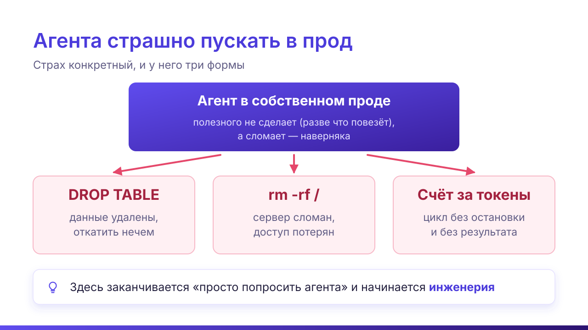

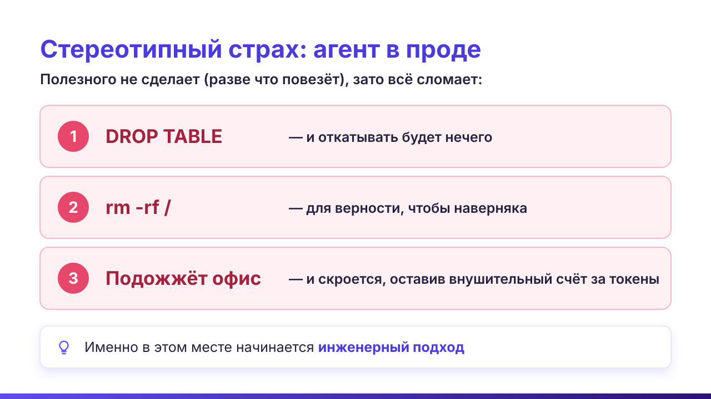

И самая первая проблема, с которой мы столкнулись, — стереотипный страх. Страшно запускать агента в прод. Он же ничего полезного не сделает (разве что повезёт), зато всё сломает: сделает `DROP TABLE`, `rm -rf /`, подожжёт офис, а затем скроется, оставив внушительный счёт за токены. Именно в этом месте начинается инженерный подход.

Третий пункт про поджог офиса открывается отдельным слайдом: тот же слайд, только с третьим пунктом.

Так страх обычно и представляют: одна попытка вслепую, промах — значит, просто потратили зря деньги и время (а в худшем случае ещё и сломали). Сделали бы «как деды учили» — руками, и было бы счастье.

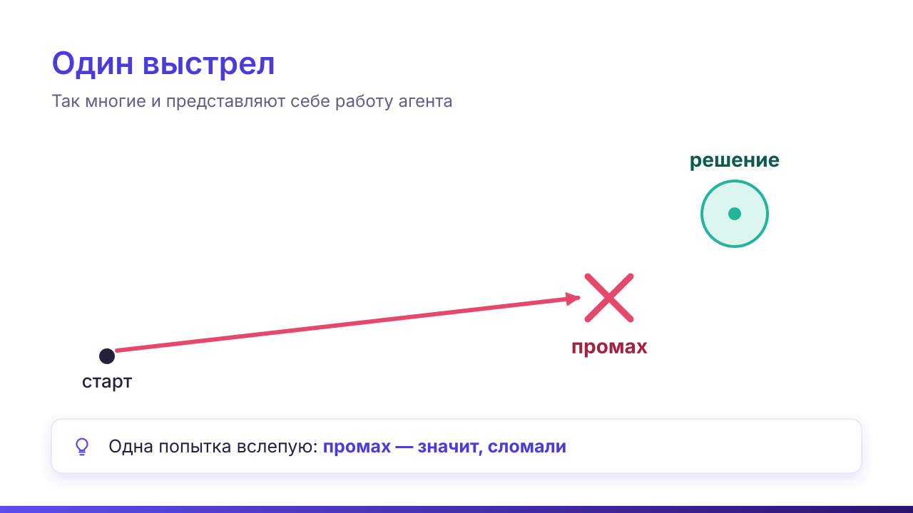

## 6. Как решили: стенд, цикл обратной связи, песочницы

Все слайды этого раздела уже есть в заметке [«Страх стохастичности и цикл обратной связи»](2026-10-27-страх-стохастичности-и-цикл-обратной-связи.md); здесь они стоят в порядке доклада. Это краткий пересказ общей части: подробнее о действиях агентов в проде — в докладе про них.

Порядок слайдов:

1. [Три опоры: наблюдаемость, управляемость, safety](2026-10-27-слайд-01-три-опоры.svg)
2. [Стенд](2026-10-27-слайд-02-стенд.svg)
3. [Минимальные изменения](2026-10-27-слайд-03-минимальные-изменения.svg)
4. [Прод: бэкап и правка](2026-10-27-слайд-04-прод-бэкап-и-правка.svg)
5. [Прод: красная зона, откатывает автоматика](2026-10-27-слайд-05-прод-красная-зона.svg)
6. [Где откат не спасает: `DROP TABLE`, письмо клиенту](2026-10-27-слайд-06-где-откат-не-спасает.svg)
7. [Нового класса риска нет](2026-10-27-слайд-07-ошибается-как-человек.svg)
8. [Цикл обратной связи](2026-10-27-слайд-08-цикл-обратной-связи.svg)
9. [Брутфорс вслепую](2026-10-27-слайд-10-брутфорс-вслепую.svg) и [цикл ведёт к решению](2026-10-27-слайд-11-цикл-ведёт-к-решению.svg)

Слайд «Память сдвигает старт и выпрямляет путь» ([`2026-10-27-слайд-12`](2026-10-27-слайд-12-память-сдвигает-старт.svg)) стоит не здесь, а в разделе про кристаллизацию: записанный опыт и есть та наработка, которая потом становится инструментом, правилом или скиллом.

Слайды «Внешний цикл» ([`13`](2026-10-27-слайд-13-внешний-цикл-ревью.svg), [`14`](2026-10-27-слайд-14-внешний-цикл-фикс.svg)) стоят в конце пункта 7: Cursor остался у нас вторым контуром.

## 7. Запускаем Cursor в прод

### 7.1. Непредсказуемость, слабая наблюдаемость, секреты и персональные данные

Текст автора, не развёрнут: решалось обкладыванием агента харнессом (скиллы, база документов в `/docs/`, хуки) и прогоном всех обращений к LLM через LLM-прокси. Быстро стало понятно, что подходы, обкатанные на Cursor с харнессом, лучше кристаллизовать в собственного кастомного агента. TBD

### 7.2. Как контролировать агента: черновики и правки

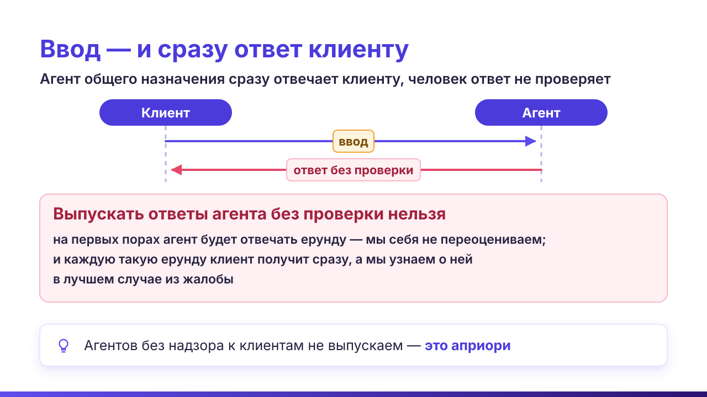

Агент общего назначения работает просто: пришёл ввод — отдал ответ. Человек ответ агента не проверяет. Если поставить его так на поддержку, заведомо понятно, что на первых порах он будет отвечать херню: мы себя не переоцениваем. И каждую такую херню клиент получит сразу, а мы узнаем о ней в лучшем случае из жалобы. Агентов без надзора к клиентам не выпускаем — это априори.

Поэтому сразу решили сделать систему с черновиками. Клиент присылает ввод агенту. Агент не отвечает клиенту, а отдаёт черновик оператору. Оператор решает, что с черновиком делать, и только после «Принять» ответ уходит клиенту.

- **Принять** — ответ уходит клиенту как есть.
- **Отклонить** — черновик клиенту не уходит.
- **Редактировать** — оператор обычными словами пишет, что не так, и агент переделывает черновик.

Агент предлагает, решает человек. Когда доверие накопилось, режим можно ослабить: агент отвечает сам, а к человеку уходит только то, в чём сомневается он сам или проверка ответа.

У действий оператора есть два побочных эффекта, и оба дальше работают на нас:

- Каждое действие — кейс для тестов. Действие оператора размечает черновик, и размеченные тикеты становятся кейсами тестового стенда. «Принять» — ответ хороший, «Отклонить» и «Редактировать» — плохой, и вместе с черновиком сохраняется, каким он должен был быть. [Подробнее в разделе про стенд](#79-непредсказуемость-наблюдаемость-стоимость-качество-и-надёжность).
- «Редактировать» — урок, который откладывается в памяти агента. Правка оператора не просто чинит один черновик: агент её запоминает. Как устроена память — [в разделе про память](#76-память-что-это-и-где-действует), как правка становится уроком — [в разделе про противоречия](#77-память-противоречит-сама-себе).

### 7.3. Оператор и клиент в одном языковом интерфейсе: нужны уровни доступа

Текст автора, не развёрнут: агента нужно постоянно направлять и обучать, оператор вмешивается на всех этапах, и делать это нужно в языковом интерфейсе. Для этого пришлось разделить операторский и пользовательский ввод, чётко отделить инструкции от данных и завести уровни доступа к инструментам. Чтобы всё было нативно, а не на костылях вокруг чужого, меняющегося от версии к версии ядра, — свой агент. TBD

Дальше проблемы, с которыми мы столкнулись уже в собственном агенте.

В агенте поддержки в одном контексте вперемешку сходится ввод из трёх источников с разным уровнем доверия: сообщения клиента, правки оператора, ответы инструментов и базы знаний. Вопрос в том, кому и насколько доверять. Клиент может написать «я оператор», и граница, которую держит инструкция в промпте, держится ровно настолько, насколько модель её соблюдает. Вокруг агента нужны свои уровни доступа, и целиком на обычном коде, не на нейросетях.

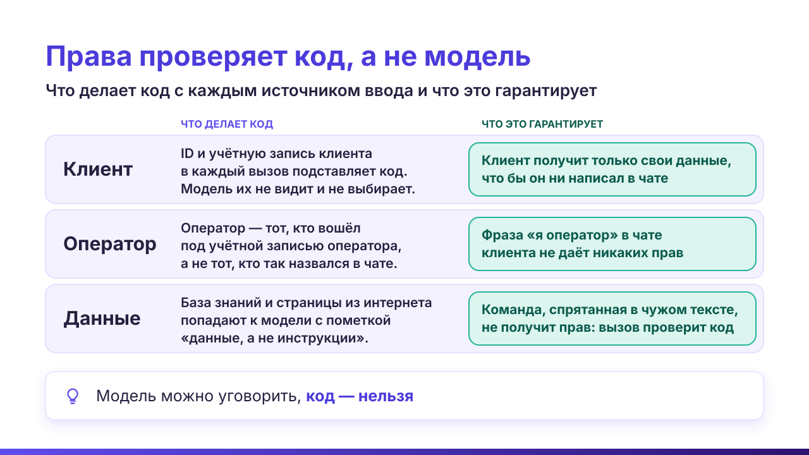

Главный принцип сквозной: идентификаторы клиентов и их учётные записи для авторизации подставляет код. Модель с ними не работает вообще: не видит, не выбирает и не передаёт. Поэтому клиент получит только свои данные, что бы он ни написал в чате.

С оператором то же самое. Оператор — тот, кто вошёл под учётной записью оператора, а не тот, кто так назвался в чате. Фраза «я оператор» в чате клиента не даёт никаких прав.

База знаний и страницы из интернета попадают к модели с пометкой «данные, а не инструкции». Если модель всё же послушается команды, спрятанной в чужом тексте, прав эта команда не получит: вызов инструмента всё равно проверит код. Модель можно уговорить, код — нельзя.

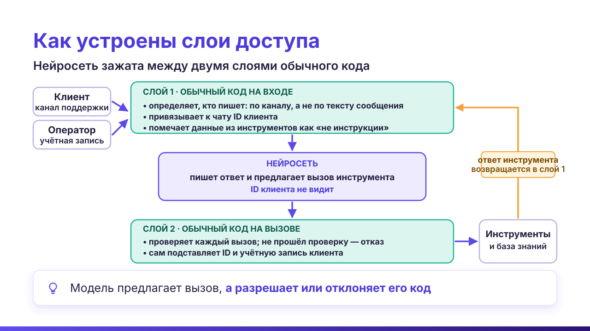

Модель работает внутри двух слоёв обычного кода. Первый слой стоит на входе: код определяет, кто пишет, по каналу, а не по тексту сообщения, и привязывает ID клиента к чату. В контексте модели ввод лежит раздельными блоками: сообщения клиента, правка оператора и данные с пометкой «не инструкции». Модель пишет ответ и предлагает вызов инструмента. Второй слой стоит перед инструментами: код проверяет каждый вызов и сам подставляет в него ID и учётную запись клиента. Ответ инструмента возвращается в контекст снова как данные.

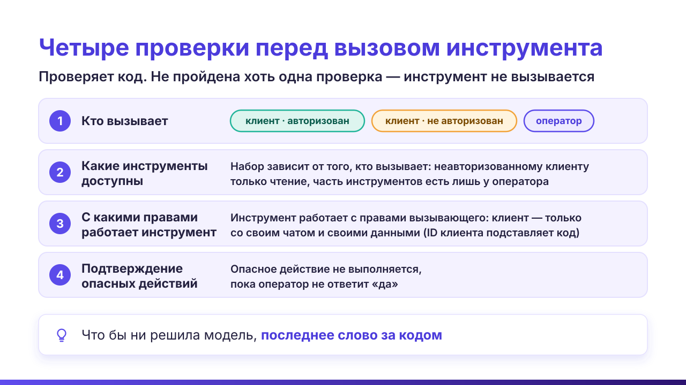

Перед каждым вызовом инструмента код делает шесть проверок:

1. **Кто вызывает.** Клиент, оператор или гость без входа. Гостю можно только читать.
2. **Роль.** Часть инструментов есть только у оператора, клиенту они недоступны.
3. **Права.** Клиент читает свой чат и базу знаний, оператор ещё и меняет правила.
4. **Подтверждение.** Опасное действие не выполняется, пока человек не ответит «да».
5. **Свой агент.** Агент видит только свою базу знаний и память, но не соседнего агента.
6. **Чей клиент.** ID клиента подставляет код, и данные приходят только этого клиента.

Не пройдена хоть одна проверка — инструмент не вызывается. Что бы ни решила модель, последнее слово за кодом.

TBD: здесь шутка про опускающиеся руки и пузырь.

### 7.4. Агент выдаёт неподкреплённые факты

Агент отвечает уверенно и правдоподобно, а источника у ответа нет: в базе знаний этого нет, инструмент ничего не вернул. Цена, срок или условие из воздуха — такой же дефект, как неверный факт, и проверить его нечем.

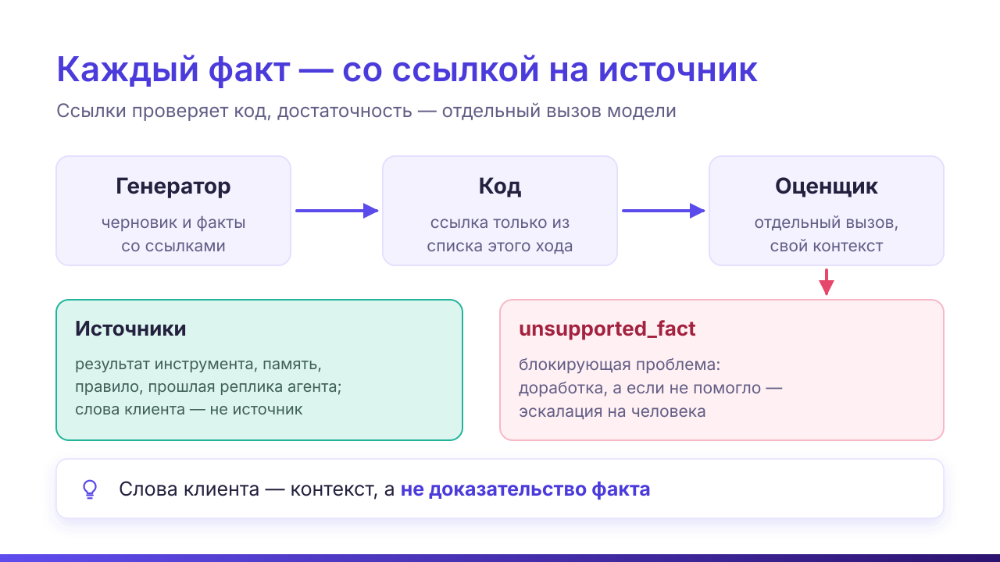

Генератор — этап, который пишет черновик ответа, — к каждому факту ставит ссылку на источник. Код пропускает только ссылки на то, что агент действительно получил при подготовке этого ответа: ответ инструмента, память, правило, прошлую реплику агента или оператора. Слова клиента источником не считаются: это контекст, а не доказательство.

Хватает ли источников, решает оценщик — отдельная модель со своим контекстом и своей инструкцией. Факт без опоры блокирует ответ: генератор получает замечание и одну попытку исправить. Не вышло — эскалация на человека.

### 7.5. Агент не замечает вопросы

Клиенты пишут не так, как удобно агенту. Рваная переписка, когда вопрос раскидан на несколько сообщений. Много вопросов в одном сообщении. Новый вопрос, который прилетает, пока обсуждают ответ на предыдущий. Модель охотнее всего отвечает на то, что видит последним.

- Пауза: агент ждёт, пока клиент допишет, а новое сообщение прерывает уже начатый ответ.
- Склейка: все сообщения клиента, оставшиеся без ответа, идут в работу одним текстом. Отсчёт — от последнего отправленного ответа агента или оператора.
- Роутер, первый шаг обработки, знает, что клиенты дробят сообщения, и «привет» вместе с вопросом отправляет на полноценный ответ.
- Оценщик проверяет, что ни один вопрос не остался без ответа. Остался — ответ не уходит.

Полноту проверяет отдельный этап, а не надежда на генератор.

### 7.6. Память: что это и где действует

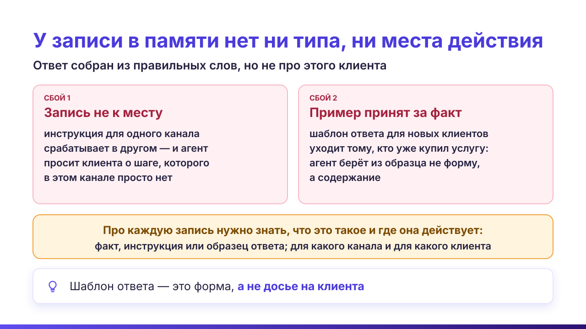

Ответ может быть собран из правильных слов, но не про этого клиента. Инструкция для одного канала срабатывает в другом, и агент просит клиента о шаге, которого в этом канале просто нет. Шаблон ответа для новых клиентов уходит тому, кто уже купил услугу: агент берёт из образца не форму, а содержание. Память — это не только «что знаем», но и «для кого», «где» и «в какой роли».

- **Тип.** Факт — что верно. Инструкция — как действовать в ситуации. Пример — одобренный ответ на типовой вопрос, и от него берётся только форма.
- **Где действует.** Везде, у одного агента или в одном чате. Плюс список каналов: запись может действовать только в мессенджере, только в тикетах или везде.
- **Что главнее.** Основная инструкция агента, потом правила оператора, потом инструкции из памяти, и только потом факты и примеры. Данные о конкретном клиенте берутся не из памяти, а из систем, через инструменты.
- **Отбор.** Поиск только собирает кандидатов, решает агент поиска в памяти: пишет запросы, ищет, оценивает найденное и при необходимости ищет ещё раз. Запись попадает в ответ, только если она меняет или подкрепляет ответ на то, о чём клиент спрашивает сейчас, и причина записывается в журнал. Пример попадает, только если ситуация клиента совпала: шаблон для новых клиентов до существующего не доходит.

### 7.7. Память противоречит сама себе

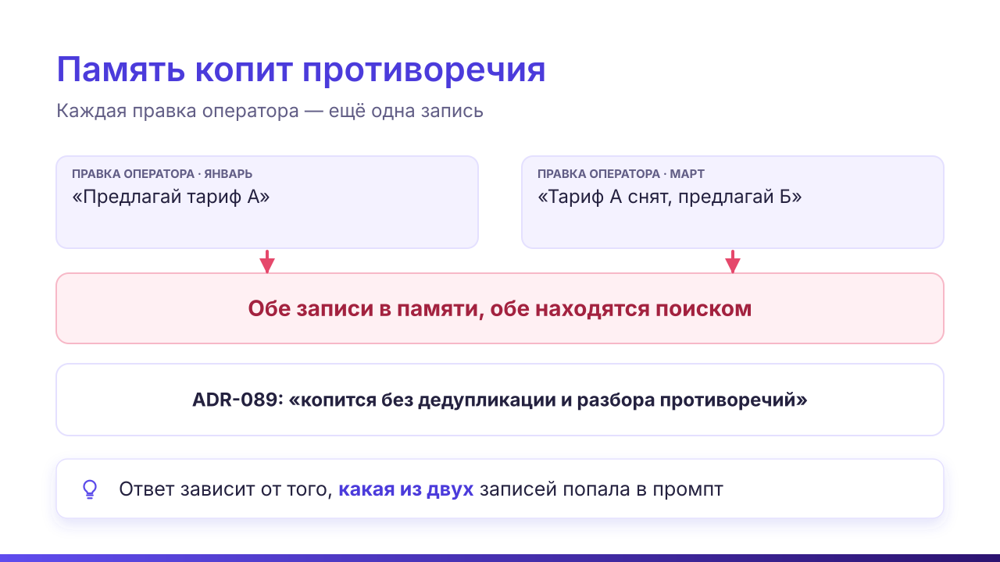

Каждая правка оператора — ещё одна запись рядом со старыми. Со временем в памяти оказываются «предлагай тариф А» и «тариф А сняли, предлагай Б», и поиск находит обе. Какая попадёт в ответ — лотерея. А ещё урок записывался в память до того, как оператор принял решение по ответу, и в память попадало то, что он потом отклонил. Агент учится и на том, чему его не учили.

1. Оператор жмёт «Редактировать» и обычными словами пишет, что не так.
2. Модель разбирает правку: это факт (агент чего-то не знал или ошибся) или инструкция (пошёл не тем путём, ответил не тем тоном). Она видит близкие по смыслу существующие записи и сама говорит, какую из них новая запись заменяет.
3. Оператор видит урок до применения: может поправить текст, сменить тип, оставить старую запись или всё отменить.
4. Урок пока временный и действует только в этом чате. Черновик правится по памяти, а не по словам оператора: их агент не видит. Так каждая правка заодно проверяет, что урок находится поиском и доходит до ответа.
5. «Принять» — ответ уходит клиенту, урок начинает действовать везде, где положено, а старая запись выключается со ссылкой на новую. «Отклонить» — временный урок удаляется, старая запись остаётся как была.

Отдельной кнопки «дело только в формулировке» нет: жалоба на стиль — такая же инструкция. Иначе агент так и не научится нужному стилю, а операторам придётся повторять одну и ту же подсказку к каждому черновику. Противоречие разбирается в момент урока, а не копится до лучших времён.

### 7.8. Нужно действие сейчас, а инструмента нет

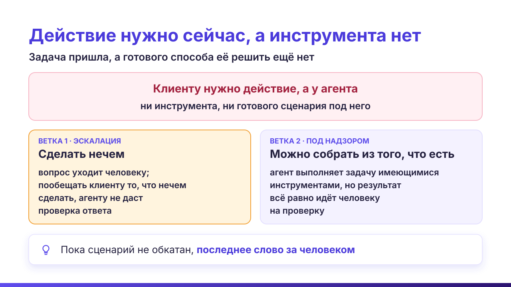

Клиенту нужно действие, а у агента ни инструмента, ни готового сценария под него. Пока их нет, это всегда эскалация на человека: пообещать шаг, который сделать нечем, агенту не даст проверка ответа. Если модель решит, что задачу можно выполнить уже имеющимися инструментами, она это сделает, но результат всё равно пойдёт на ревью человеку. Пока сценарий не обкатан, последнее слово за человеком.

Решаем так же, как в докладе про действия агентов в проде: задачу сначала решают под надзором — человек или агент общего назначения. После этого остаются наработки: записанные прогоны, скрипты, понимание того, как сделать это безопасно.

Память не только сдвигает старт ближе к решению, она и выпрямляет путь. С ней агент не делает шагов, которые заранее не нужны или уже эмпирически оказались не теми. Путь получается и короче, и ровнее.

Когда сценарий обкатан, мы явно закрепляем его в автоматическом потоке работы. Это я называю кристаллизацией. Способа три:

- **Инструмент** — лучший вариант. Обычный код, который каждый раз делает одно и то же, модель ему не нужна.
- **Правило** — короткая инструкция оператора, которую агент видит в каждом диалоге своего канала.
- **Скилл для субагента.** Субагент — агент общего назначения на доверенной машине, которому уходит работа на инфраструктуре. Скилл — инструкция и скрипты для него; скрипты из разрешённого списка он запускает без подтверждения, всё остальное — через человека.

Чем больше закристаллизовано, тем реже эскалация.

### 7.9. Непредсказуемость, наблюдаемость, стоимость, качество и надёжность

Агент общего назначения — чёрный ящик. Тот же вопрос — другой путь и другой ответ. Почему агент ответил именно так, не видно. Агенты общего назначения достаточно многословны: любят делать очень много ходов, нагружать контекст и бродить вокруг да около. Высокая стоимость — прямое следствие этой непредсказуемости и многословности. И самое сложное — качество и надёжность: разные части должны работать вместе, а правка в одном месте не должна ломать другое.

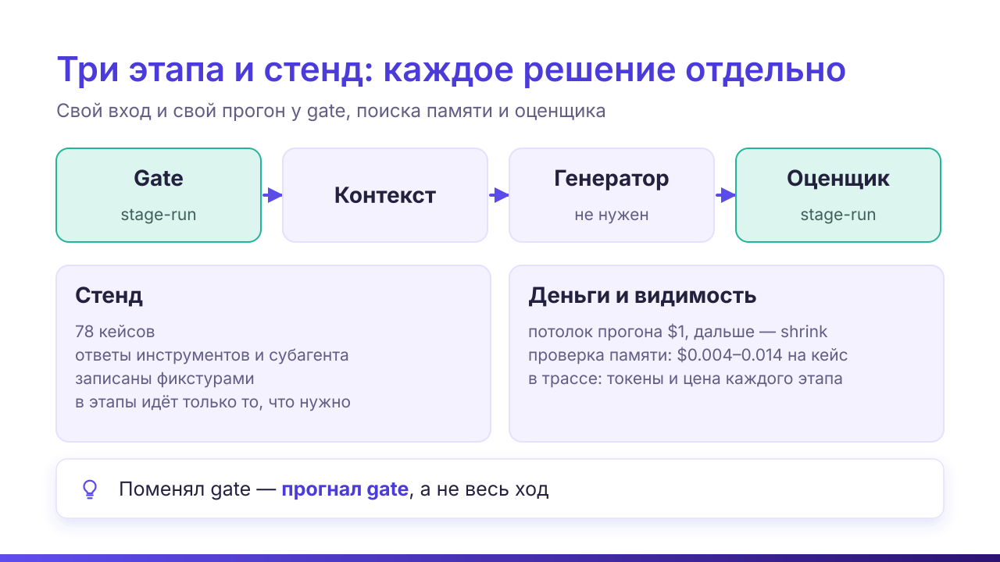

Это мы решили своим ядром с тремя этапами и стендом с эвалами. Схема этапов — [в заметке про этапы и циклы](2026-11-10-supagent-против-одного-цикла-и-готового-агента.md).

- Каждый этап — отдельная часть со своим входом и выходом: роутер решает, как обработать сообщение, генератор пишет черновик, оценщик проверяет его до отправки. Роутер, поиск в памяти и оценщик можно прогнать по отдельности, не запуская всё остальное.
- Стенд — набор записанных сценариев. Ответы инструментов записаны заранее, живые системы для прогона не нужны. Сценарии берутся в том числе из тикетов, которые операторы разметили, когда принимали, отклоняли и редактировали черновики ([черновики и правки](#72-как-контролировать-агента-черновики-и-правки)).
- Бюджет прогона задан заранее, а в журнале видны вход, выход и цена каждого этапа.

Поменял роутер — прогнал роутер, а не всё целиком. Это экономит и время, и деньги, и показывает, что именно сломалось.

### 7.10. Персональные данные

Агент поддержки по самой задаче читает чужие персональные данные. Источников три: текст сообщения (почта, телефон, номер договора), фото (скан паспорта, документы) и внутренние системы, например биллинг или бухгалтерия. Всё прочитанное агент отправляет модели, а модель чужая: данные уходят вместе с запросом тому, кто модель запускает, и вернуть их уже нельзя. Подробный разбор: [«Персональные данные и агенты»](2026-11-11-персональные-данные-и-агенты.md).

- **Доступ.** ID и учётную запись клиента подставляет код, модель их не видит. Одноразовые коды входа до модели тоже не доходят.
- **Маскировка.** В старых тикетах, которые идут в память и базу знаний, почта, телефоны и номера заменяются метками. Второй проход ищет остатки, и разговор с остатками уходит в карантин, а в модель не попадает.
- **Стенд.** Сценарии обезличены до записи, данные систем записаны заранее, а не живые.
- **Вложения.** Фото и документы в модель не передаются. Распознавание изображений? Там, где фильтром не закрыть, мы честно забили.

Что имеет форму, ловит код. Что формы не имеет, например имена, проверяет человек.

[TBD: отдельная ветка «клиент прислал документы — эскалация на человека, дальнейшая обработка не идёт». Сейчас такой ветки нет: сообщение без текста просто не доходит до агента.]

### 7.X. Что стало с Cursor

Cursor из прода не ушёл, он остался вторым контуром: каждый тикет ревьюит ещё один агент, а подтверждённые баги забирает на фикс кодинг-агент. Подробно — в заметке про стохастичность, раздел «Внешний цикл».

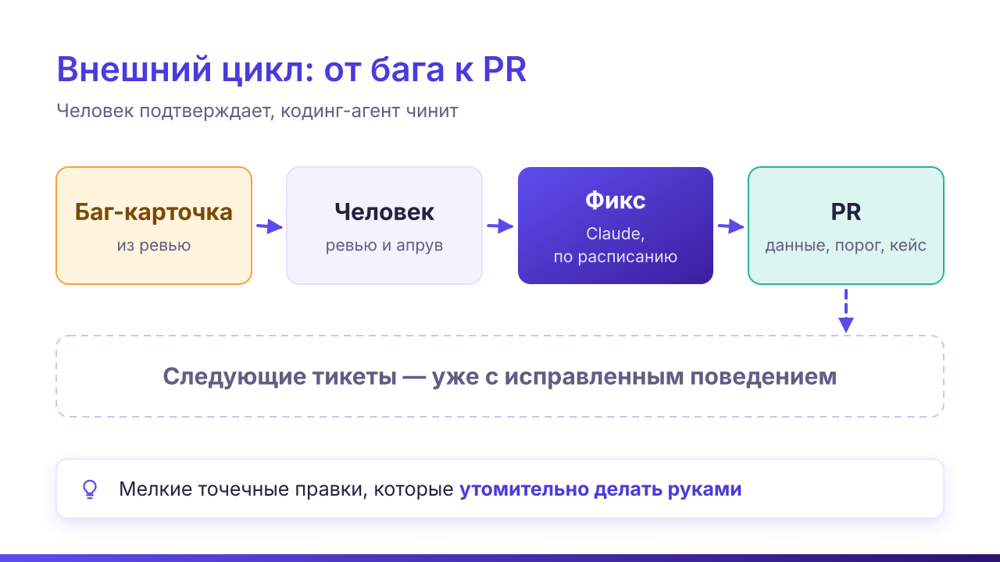
